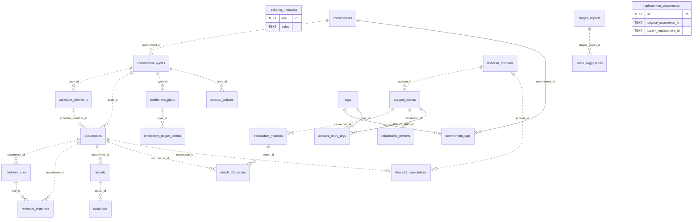

<div dir="rtl" lang="fa">

# راهنمای جامع پایگاه دادهٔ <span dir="ltr">PlanAct</span>

این سند مرجع توسعه‌دهنده برای **ساختار فعلی ذخیره‌سازی**، جدول‌ها، ستون‌ها، ارتباط‌ها و قواعد کار با پایگاه داده است. مبنا: کد مخزن در <span dir="ltr">۲۰۲۶-۱۰-۱۴</span>، نسخهٔ برنامه <span dir="ltr">`0.1.15+8`</span> و طرحواره شخصی **۱۸**. وجود یک جدول به‌تنهایی به معنی آماده‌بودن قابلیت متناظر برای انتشار نیست.

مرجع اجرایی طرحواره، [<span dir="ltr">app_database.dart</span>](../lib/core/database/app_database.dart) است؛ کد <span dir="ltr">SQL</span> تولیدشده در [<span dir="ltr">app_database.g.dart</span>](../lib/core/database/app_database.g.dart) قرار دارد. رفتار محصول از [<span dir="ltr">PRD</span>](product/PRD.md)، تصمیم‌های مصوب از [<span dir="ltr">ADR</span>ها](adr/) و قواعد پیاده‌سازی از [<span dir="ltr">AGENTS.md</span>](../AGENTS.md) می‌آیند. این سند آن منابع را توضیح می‌دهد و تصمیم جدیدی دربارهٔ رفتار داده‌ها ایجاد نمی‌کند.

## فهرست

1. [معماری و فایل‌های پایگاه داده](#1-storage)
2. [انواع جدول و فهرست کامل](#2-catalog)
3. [نمای کلی و روابط](#3-relations)
4. [قرارداد نام‌گذاری و نوع داده](#4-types)
5. [فرهنگ ستون‌های تمام جدول‌ها](#5-columns)
6. [کدهای نوع شمارشی ذخیره‌شده](#6-enums)
7. [<span dir="ltr">JSON</span>، فراداده و داده‌های خارج از ستون‌های اصلی](#7-metadata)
8. [قیود، نمایه‌ها و محرک‌های پایگاه داده](#8-constraints)
9. [قواعد نوشتن، تاریخچه و محاسبات](#9-writes)
10. [نسخه‌بندی و مهاجرت پایگاه داده](#10-migrations)
11. [پشتیبان، بازیابی و امنیت](#11-backup)
12. [راهنمای کار و بررسی برای توسعه‌دهنده](#12-development)
13. [دامنهٔ صحت این سند و نگهداری آن](#13-evidence)

<a id="1-storage"></a>

## ۱. معماری و فایل‌های پایگاه داده

<span dir="ltr">PlanAct</span> یک برنامهٔ متکی بر ذخیره‌سازی محلی است. پایگاه دادهٔ اصلی رابطه‌ای و مبتنی بر **<span dir="ltr">SQLite</span> با <span dir="ltr">Drift</span>** است؛ فایل روی دستگاه نگهداری می‌شود و کارکرد اصلی به سرور، حساب ابری یا اینترنت وابسته نیست.

| فایل | کاربرد | نسخه / مالک |
| ---: | ---: | ---: |
| <span dir="ltr">`planact.sqlite`</span> | داده‌های شخصی، تعهد، زمان‌بندی، مالی، صندوق بررسی و تنظیمات | <span dir="ltr">`AppDatabase`</span>، طرحواره 18 |
| <span dir="ltr">`holiday-packages.sqlite`</span> | بسته‌های عمومی و امضاشدهٔ تعطیلات | <span dir="ltr">`SqliteHolidayPackageStore`</span>، <span dir="ltr">`user_version = 1`</span> |
| <span dir="ltr">`planact-schema-reference.sqlite`</span> | ساخت موقت طرحواره مرجع برای اعتبارسنجی بازیابی؛ پس از خواندن حذف می‌شود | نقطهٔ اتصال وابستگی‌های برنامه |
| <span dir="ltr">`planact.sqlite.restore-safety`</span> | نسخهٔ لحظه‌ای ایمنی پیش از جایگزینی | چرخهٔ بازیابی |
| <span dir="ltr">`planact.sqlite.restore-new`</span> | فایل آمادهٔ جایگزینی | چرخهٔ بازیابی |
| <span dir="ltr">`planact.sqlite.restore-marker`</span> | نشانگر بازیابی در صورت قطع فرایند؛ پایگاه داده نیست | چرخهٔ بازیابی |
| <span dir="ltr">`planact.sqlite.restore-validation`</span> / <span dir="ltr">`.export-snapshot`</span> | فایل موقت اعتبارسنجی / نسخهٔ لحظه‌ای خروجی | رابط زیرساختی پشتیبان |

مسیر اصلی در [<span dir="ltr">BackupApplicationScope</span>](../lib/app/backup_application_scope.dart) از <span dir="ltr">`getApplicationDocumentsDirectory()`</span> گرفته می‌شود. این فایل‌ها را با مسیر ثابت مخصوص سیستم‌عامل باز نکنید. ذخیره‌ساز تعطیلات مستقل از نسخهٔ لحظه‌ای شخصی است؛ بازیابی شخصی آن را جایگزین نمی‌کند.

در نقطهٔ اتصال وابستگی‌های برنامه، یک نمونهٔ <span dir="ltr">`AppDatabase`</span> ساخته و در اختیار مخزن‌های داده قرار می‌گیرد. [<span dir="ltr">AppDatabaseLifecycle</span>](../lib/core/database/app_database_lifecycle.dart) مسئول بازکردن و بستن آن است؛ مخزن داده نباید اتصال را ببندد. اتصال اصلی با <span dir="ltr">`NativeDatabase.createInBackground`</span> اجرا می‌شود. <span dir="ltr">`AppDatabase.forTesting`</span> و مخزن‌های درون‌حافظه‌ای برای آزمون و پیش‌نمایش هستند.

مسیر دسترسی:

1. رویداد رابط کاربری.
2. فراخوانی فرمان / مورد کاربرد در لایهٔ کاربرد.
3. اعتبارسنجی دامنه.
4. اجرای مخزن داده و تراکنش در لایهٔ داده و نوشتن در <span dir="ltr">SQLite</span>.
5. خواندن مجدد و تازه‌سازی مصرف‌کنندگان.
6. اجرای اثر سیستم‌عامل پس از ثبت قطعی تراکنش، در مسیرهای مربوط.

رابط کاربری نباید جدول را مستقیم تغییر دهد؛ دامنه هم نباید به <span dir="ltr">Drift</span> یا <span dir="ltr">Flutter</span> وابسته شود. تقویم، امروز و موارد نیازمند توجه نمای محاسبه‌شده هستند و پایگاه دادهٔ مستقل یا منبع حقیقت موازی ندارند.

<a id="2-catalog"></a>

## ۲. انواع جدول و فهرست کامل

از نظر فیزیکی، تمام **۲۴ جدول شخصی**، جدول عادی <span dir="ltr">SQLite</span> هستند؛ در تعریف فعلی <span dir="ltr">`AppDatabase`</span> هیچ نمای پایگاه داده، نمای ذخیره‌شده یا جدول مجازی ثبت نشده است. «نوع جدول» در فهرست زیر نقش معماری آن را مشخص می‌کند:

- **موجودیت اصلی:** هویت و وضعیت یک مفهوم پایدار.
- **پیکربندی:** قواعدی که رفتار آینده را تعیین می‌کنند.
- **رویداد/تاریخچه:** یک اتفاق برنامه‌ریزی‌شده یا ثبت‌شده.
- **دفتر کل:** ردیف‌های مبنای محاسبهٔ اعتبار یا موجودی.
- **واسط:** عضویت یا تخصیص در رابطهٔ چندبه‌چند.
- **ممیزی:** تصمیم‌های کاربر و دادهٔ لازم برای تشخیص تغییر/تعارض.
- **عملیاتی:** درخواست ثبت‌شده یا وضعیت هماهنگی با رابط زیرساختی.
- **ذخیره‌سازی موقت برای بررسی:** دادهٔ ورودی و پیشنهاد پیش از تأیید کاربر.
- **کلید–مقدار:** تنظیمات و محتواهای دادهٔ نسخه‌دار.

| نام <span dir="ltr">SQLite</span> | کلاس <span dir="ltr">Drift</span> | نوع / نقش |
| ---: | ---: | ---: |
| <span dir="ltr">`schema_metadata`</span> | <span dir="ltr">`SchemaMetadata`</span> | کلید–مقدار؛ نسخه، تنظیمات، فراداده و بخشی از سابقهٔ ممیزی |
| <span dir="ltr">`commitments`</span> | <span dir="ltr">`Commitments`</span> | موجودیت اصلی؛ تعهد پایدار |
| <span dir="ltr">`commitment_cycles`</span> | <span dir="ltr">`CommitmentCycles`</span> | موجودیت دوره/ترم/بستهٔ تعهد |
| <span dir="ltr">`schedule_definitions`</span> | <span dir="ltr">`ScheduleDefinitions`</span> | پیکربندی نسخه‌دار زمان‌بندی |
| <span dir="ltr">`occurrences`</span> | <span dir="ltr">`Occurrences`</span> | نوبت برنامه‌ریزی‌شده و وضعیت تاریخی آن |
| <span dir="ltr">`entitlement_plans`</span> | <span dir="ltr">`EntitlementPlans`</span> | پیکربندی اعتبار/حق استفادهٔ یک دوره |
| <span dir="ltr">`entitlement_ledger_entries`</span> | <span dir="ltr">`EntitlementLedgerEntries`</span> | دفتر کل اعتبار |
| <span dir="ltr">`session_policies`</span> | <span dir="ltr">`SessionPolicies`</span> | پیکربندی مصرف، غیبت و جبرانی |
| <span dir="ltr">`replacement_occurrences`</span> | <span dir="ltr">`ReplacementOccurrences`</span> | رکورد جبرانی و زنجیرهٔ جبرانی‌ها |
| <span dir="ltr">`reminder_rules`</span> | <span dir="ltr">`ReminderRules`</span> | پیکربندی یادآور برای نوبت |
| <span dir="ltr">`reminder_instances`</span> | <span dir="ltr">`ReminderInstances`</span> | درخواست ثبت‌شده عملیاتی اعلان مشخص |
| <span dir="ltr">`actuals`</span> | <span dir="ltr">`Actuals`</span> | تاریخچهٔ نتیجهٔ واقعی |
| <span dir="ltr">`evidences`</span> | <span dir="ltr">`Evidences`</span> | شاهد/ارجاع مربوط به نتیجه |
| <span dir="ltr">`financial_accounts`</span> | <span dir="ltr">`FinancialAccounts`</span> | موجودیت حساب مالی |
| <span dir="ltr">`account_entries`</span> | <span dir="ltr">`AccountEntries`</span> | دفتر کل مالی؛ رکورد تراکنش قابل تطبیق نیز همین است |
| <span dir="ltr">`transaction_matches`</span> | <span dir="ltr">`TransactionMatches`</span> | سرآیند ارتباط تراکنش و وضعیت اصلاح آن |
| <span dir="ltr">`match_allocations`</span> | <span dir="ltr">`MatchAllocations`</span> | واسط مبلغ‌دار میان تطبیق و نوبت |
| <span dir="ltr">`relationship_reviews`</span> | <span dir="ltr">`RelationshipReviews`</span> | ممیزی تصمیم مستقل/بازگشایی تراکنش |
| <span dir="ltr">`financial_expectations`</span> | <span dir="ltr">`FinancialExpectations`</span> | مبلغ برنامه‌ریزی‌شدهٔ اختیاری برای نوبت |
| <span dir="ltr">`tags`</span> | <span dir="ltr">`Tags`</span> | واژگان مشترک برچسب‌ها |
| <span dir="ltr">`commitment_tags`</span> | <span dir="ltr">`CommitmentTags`</span> | واسط تعهد–برچسب |
| <span dir="ltr">`account_entry_tags`</span> | <span dir="ltr">`AccountEntryTags`</span> | واسط ردیف مالی–برچسب |
| <span dir="ltr">`staged_imports`</span> | <span dir="ltr">`StagedImports`</span> | ذخیره‌سازی موقت برای بررسی ورودی و منشأ آن |
| <span dir="ltr">`inbox_suggestions`</span> | <span dir="ltr">`InboxSuggestions`</span> | پیشنهاد مالی قابل بررسی |

در پایگاه داده دوم، <span dir="ltr">`holiday_packages`</span> جدول مرجع عمومی است و در شمار ۲۴ جدول بالا نیست. جدول فیزیکی جداگانه‌ای به نام <span dir="ltr">`financial_transactions`</span>، <span dir="ltr">`attachments`</span>، <span dir="ltr">`remaining_sessions`</span> یا <span dir="ltr">`account_balances`</span> در <span dir="ltr">`AppDatabase`</span> وجود ندارد.

<a id="3-relations"></a>

## ۳. نمای کلی و روابط

### ۳.۱. نقشهٔ مفهومی

- **زمان‌بندی:** تعهد ← دوره ← تعریف زمان‌بندی ← نوبت.
- **اعتبار:** دوره ← برنامهٔ اعتبار ← دفتر کل اعتبار؛ سیاست جلسه نیز به دوره مربوط است.
- **یادآوری:** نوبت ← قانون یادآور ← نمونهٔ اعلان.
- **نتیجه:** نوبت ← نتیجهٔ واقعی ← شاهد.
- **مالی:** حساب مالی ← ردیف حساب ← تطبیق ← تخصیص پرداخت؛ تخصیص به نوبت مربوط می‌شود و نوبت می‌تواند انتظار مالی داشته باشد.
- **بررسی ارتباط:** ردیف حساب ← تاریخچهٔ بررسی ارتباط.
- **برچسب:** تعهد / ردیف حساب ↔ برچسب.
- **ورود اطلاعات:** ورودی آمادهٔ بررسی ← پیشنهاد صندوق بررسی ← تأیید صریح ← ردیف حساب.

پیکان‌های نقشهٔ مفهومی الزاماً نشان‌دهندهٔ کلید خارجی نیستند. برای نمونه، تأیید پیشنهاد صندوق بررسی با فرمان برنامه انجام می‌شود و میان پیشنهاد و ردیف حساب، ستون کلید خارجی مستقیمی وجود ندارد. موجودیت‌های مفهومی سند نیازمندی محصول را با جدول‌های فیزیکی یکسان فرض نکنید؛ مثلاً <span dir="ltr">`reminder_rules`</span> در ساختار فعلی به نوبت متصل است، نه مستقیماً به دوره.

### ۳.۲. نمودار روابط پایگاه دادهٔ شخصی

نمودار زیر **روابط <span dir="ltr">FK</span> تعریف‌شده در طرحوارهٔ تازهٔ ۱۸** را نشان می‌دهد. `||` یعنی دقیقاً یک والد و <span dir="ltr">`o{`</span> یعنی صفر یا چند فرزند؛ <span dir="ltr">`o|`</span> یعنی صفر یا یک. وجود <span dir="ltr">FK</span> به‌تنهایی الزام نمی‌کند والد فرزند داشته باشد. خط پیوسته برای رابطه‌ای است که <span dir="ltr">FK</span> بخشی از <span dir="ltr">PK</span> فرزند است؛ خط نقطه‌چین برای فرزند دارای هویت مستقل است؛ هر دو <span dir="ltr">FK</span> واقعی‌اند. <span dir="ltr">`schema_metadata`</span> و <span dir="ltr">`replacement_occurrences`</span> به دلیل نداشتن <span dir="ltr">FK</span> به‌صورت مستقل آمده‌اند. ردیف‌های جدول‌های واسط کلید مرکب دارند. نمودار در پیش‌نمایش <span dir="ltr">Markdown</span> سازگار با <span dir="ltr">Mermaid</span> نمایش داده می‌شود؛ نقشهٔ متنی بالا به نمایش‌دهنده وابسته نیست.

<div dir="ltr">



</div>

### ۳.۳. روابطی که باید جدا از <span dir="ltr">FK</span> فهمید

| ستون / داده | ارتباط منطقی | تضمین فعلی |
| ---: | ---: | ---: |
| <span dir="ltr">`replacement_occurrences.original_occurrence_id`</span> | نوبت اصلی | <span dir="ltr">`TEXT NOT NULL`</span>؛ <span dir="ltr">FK</span> ندارد |
| <span dir="ltr">`replacement_occurrences.parent_replacement_id`</span> | جبرانی قبلی | <span dir="ltr">`TEXT NULL`</span>؛ کلید خارجی به همان جدول ندارد؛ دامنه ارجاع به خود را رد می‌کند |
| <span dir="ltr">`entitlement_ledger_entries.reference_id`</span> | منشأ مصرف/اصلاح، مثلاً رخداد یا سابقهٔ ممیزی | ارجاع عمومی؛ <span dir="ltr">FK</span> ندارد |
| <span dir="ltr">`account_entries.reference_id`</span> | منشأ ورودی یا ردیف مالی مرتبط، بسته به فرمان | ارجاع عمومی؛ <span dir="ltr">FK</span> ندارد |
| <span dir="ltr">`account_entries.transfer_group_id`</span> | گروه دو سمت انتقال | شناسهٔ گروه؛ جدول انتقال جدا و <span dir="ltr">FK</span> ندارد |
| <span dir="ltr">`transaction_matches.corrected_match_id`</span> | تطبیق مرتبط در تاریخچهٔ اصلاح | <span dir="ltr">FK</span> ندارد؛ معنای داده را فرمان تطبیق تعیین می‌کند |
| <span dir="ltr">`inbox_suggestions.draft_id`</span> | شناسهٔ پیش‌نویس تجزیه‌گر | جدول پیش‌نویس‌ها و <span dir="ltr">FK</span> ندارد |
| <span dir="ltr">`commitments.attachment_ids`</span> / <span dir="ltr">`evidences.value`</span> | شناسه/ارجاع شاهد یا فایل | فهرست محتوا یا جدول پیوست‌ها در طرحوارهٔ فعلی نیست |
| کلیدهای مربوط به هر موجودیت در <span dir="ltr">`schema_metadata`</span> | حساب، پیشنهاد یا سابقهٔ ممیزی تعهد | هیچ <span dir="ltr">FK</span> یا پاک‌سازی حذف زنجیره‌ای روی کلیدها وجود ندارد |

از نظر <span dir="ltr">SQL</span>، یک دوره می‌تواند چند <span dir="ltr">`entitlement_plans`</span> و چند <span dir="ltr">`session_policies`</span> داشته باشد؛ <span dir="ltr">`cycle_id`</span> در این دو جدول یکتا نیست. مسیر <span dir="ltr">`findByCycle`</span> سیاست جلسه انتظار صفر/یک ردیف دارد؛ این انتظار را با تضمین ۱:۱ پایگاه داده اشتباه نگیرید. همچنین <span dir="ltr">SQL</span> تضمین نمی‌کند <span dir="ltr">`occurrences.cycle_id`</span> با دوره تعریف زمان‌بندی مربوط یکسان باشد، یا قانون و نمونه به همان رخداد اشاره کنند؛ این سازگاری‌ها مسئولیت لایهٔ کاربرد/مخزن داده نیز هستند.

<a id="4-types"></a>

## ۴. قرارداد نام‌گذاری و نوع داده

در جدول‌های بعد، نام ستون‌ها همان نام واقعی آن‌ها در <span dir="ltr">SQL</span> با قالب <span dir="ltr">`snake_case`</span> است. نام ویژگی متناظر در <span dir="ltr">Dart</span> با قالب <span dir="ltr">`camelCase`</span> نوشته می‌شود؛ مثلاً <span dir="ltr">`schedule_definition_id`</span> متناظر با <span dir="ltr">`scheduleDefinitionId`</span> است.

| علامت / نوع | معنی |
| ---: | ---: |
| <span dir="ltr">`TEXT`</span> | <span dir="ltr">`String`</span> در <span dir="ltr">Drift</span>؛ برای <span dir="ltr">UUID</span>، متن، کد یا <span dir="ltr">JSON</span> |
| <span dir="ltr">`INTEGER`</span> | <span dir="ltr">`int`</span> در <span dir="ltr">Drift</span>؛ عدد صحیح، شمارهٔ نوع شمارشی یا مبلغ |
| <span dir="ltr">`INTEGER (زمان)`</span> | <span dir="ltr">`DateTimeColumn`</span> / <span dir="ltr">`DateTime`</span>؛ مبدأ زمان یونیکس بر حسب **ثانیه** در تنظیم فعلی <span dir="ltr">Drift</span> |
| <span dir="ltr">`INTEGER (bool)`</span> | <span dir="ltr">`BoolColumn`</span> / <span dir="ltr">`bool`</span>؛ مقدار <span dir="ltr">SQL</span> صفر/یک با <span dir="ltr">CHECK</span> تولیدشدهٔ <span dir="ltr">Drift</span> |
| <span dir="ltr">NULL</span> «بله» | ستون قابل پذیرش مقدار تهی است؛ باقی ستون‌ها <span dir="ltr">`NOT NULL`</span> هستند |
| <span dir="ltr">`PK`</span> | کلید اصلی |
| <span dir="ltr">`FK → ...`</span> | <span dir="ltr">`references(...)`</span> واقعی در طرحواره جاری |
| «—» در قید | مقدار پیش‌فرض/قید اختصاصی ندارد؛ قواعد دامنه ممکن است اضافه باشند |

نکات عمومی:

- <span dir="ltr">`id`</span>های دامنه از نوع **<span dir="ltr">UUIDv7</span>** هستند؛ [<span dir="ltr">StableId</span>](../lib/core/ids/stable_id.dart) و [<span dir="ltr">ADR</span> 0002](adr/0002-uuidv7-stable-identifiers.md) مرجع‌اند. <span dir="ltr">SQL</span> برای تمام رشته‌های <span dir="ltr">`id`</span> اعتبار قالب <span dir="ltr">UUID</span> را <span dir="ltr">CHECK</span> نمی‌کند. هیچ شناسهٔ دامنه از <span dir="ltr">`rowid`</span> یا شمارندهٔ خودافزا مشتق نمی‌شود.
- استثناهای <span dir="ltr">PK</span>: <span dir="ltr">`schema_metadata.key`</span>، کلید مرکب دو جدول برچسب، و <span dir="ltr">`holiday_packages.year`</span>.
- نوع <span dir="ltr">SQLite</span> به‌تنهایی معنایی نیست: <span dir="ltr">`INTEGER`</span> می‌تواند مقدار زمان، مبلغ، نوع شمارشی یا منطقی باشد. به واحد و قالب ذخیره‌سازی هر ستون توجه کنید.
- همهٔ مبلغ‌های مالی عدد صحیح هستند؛ <span dir="ltr">`REAL`</span>/<span dir="ltr">`double`</span> برای پول استفاده نشود. واحد ذخیره‌شده ایرانی **<span dir="ltr">IRR</span>/ریال** است؛ انتخاب تومان فقط در ورودی/نمایش تبدیل دقیق انجام می‌دهد. نبود ارز در انتظار مالی را به <span dir="ltr">IRR</span> یا ارز حساب تبدیل نکنید.
- دقت ستون‌های <span dir="ltr">`DateTimeColumn`</span> فعلی ثانیه است؛ <span dir="ltr">JSON</span> و مقدار متنی نوبت ممکن است میلی‌ثانیه داشته باشند. در مقایسه و افزودن رکورد و اثرانگشت تفاوت دقت را لحاظ کنید.
- تاریخ نمایشی جلالی است، اما <span dir="ltr">`LocalDate`</span> و متن تاریخ زمان‌بندی اجزای تاریخ میلادی محلی‌اند؛ مرجع **محاسبهٔ تکرار** جدا در <span dir="ltr">JSON</span> نگهداری می‌شود. تاریخ بدون ساعت را به نیمه‌شب <span dir="ltr">UTC</span> تبدیل نکنید.
- تاریخ‌های دوره/اعتبار قابل مصرف/سیاست در طرحوارهٔ فعلی <span dir="ltr">`DateTimeColumn`</span> هستند؛ برخلاف <span dir="ltr">`schedule_definitions.start_date`</span>، ستون تاریخ بدون ساعت متنی نیستند. رابط زیرساختی فعلی آن‌ها را به <span dir="ltr">UTC</span> می‌نویسد؛ صرف نام <span dir="ltr">`*_date`</span> دلیل استفاده از قالب ذخیره‌سازی <span dir="ltr">`LocalDate`</span> نیست.
- مقدارهای پیش‌فرض <span dir="ltr">SQL</span> پایین الزاماً انتخاب پیش‌فرض مجاز در تجربهٔ کاربر نیستند. تاریخ، زمان، مبلغ یا یادآور غایب را با یک مقدار پنهان پر نکنید.

<a id="5-columns"></a>

## ۵. فرهنگ ستون‌های تمام جدول‌ها

قید <span dir="ltr">PK</span> و <span dir="ltr">FK</span> در این بخش برای **ساخت تازه با طرحواره 18** است؛ تفاوت مسیرهای مهاجرت پایگاه داده در بخش ۱۰ آمده است. قابل پذیرش مقدار تهی بودن، مقدار پیش‌فرض و نوع فیزیکی جدا از اعتبارسنجی دامنه‌اند.

### ۵.۱. <span dir="ltr">`schema_metadata`</span> — کلید–مقدار پایدار

تنظیمات و محتواهای دادهٔ نسخه‌دار را نگه می‌دارد؛ فقط جدول نسخهٔ طرحواره نیست. [جزئیات فضاهای نام](#7-metadata).

| ستون | نوع | پذیرش <span dir="ltr">`NULL`</span> | قید / مقدار پیش‌فرض | معنی |
| ---: | ---: | ---: | ---: | ---: |
| <span dir="ltr">`key`</span> | <span dir="ltr">TEXT</span> | خیر | <span dir="ltr">PK</span> | نام تنظیم/فضای نام |
| <span dir="ltr">`value`</span> | <span dir="ltr">TEXT</span> | خیر | — | رشتهٔ ساده یا <span dir="ltr">JSON</span> مطابق قرارداد کلید |

### ۵.۲. <span dir="ltr">`commitments`</span> — تعهد پایدار

یک مفهوم مانند «کلاس موسیقی»؛ دوره‌های متعدد آن هویت تعهد را عوض نمی‌کنند. برچسب‌های جاری از جدول واسط خوانده می‌شوند.

| ستون | نوع | پذیرش <span dir="ltr">`NULL`</span> | قید / مقدار پیش‌فرض | معنی |
| ---: | ---: | ---: | ---: | ---: |
| <span dir="ltr">`id`</span> | <span dir="ltr">TEXT</span> | خیر | <span dir="ltr">PK</span> | شناسهٔ تعهد |
| <span dir="ltr">`title`</span> | <span dir="ltr">TEXT</span> | خیر | — | عنوان |
| <span dir="ltr">`created_at`</span> | <span dir="ltr">INTEGER</span> (زمان) | خیر | — | زمان ایجاد |
| <span dir="ltr">`status`</span> | <span dir="ltr">INTEGER</span> | خیر | — | <span dir="ltr">`CommitmentStatus`</span> |
| <span dir="ltr">`kind`</span> | <span dir="ltr">INTEGER</span> | خیر | <span dir="ltr">DEFAULT 0</span> | <span dir="ltr">`CommitmentKind`</span> |
| <span dir="ltr">`priority`</span> | <span dir="ltr">INTEGER</span> | خیر | <span dir="ltr">DEFAULT 1</span> | <span dir="ltr">`CommitmentPriority`</span> |
| <span dir="ltr">`color_key`</span> | <span dir="ltr">TEXT</span> | بله | <span dir="ltr">CHECK</span> هشت رنگ مجاز | هویت رنگی؛ <span dir="ltr">NULL</span> از پالت رنگ مشترک مقدار جایگزین می‌گیرد |
| <span dir="ltr">`description`</span> | <span dir="ltr">TEXT</span> | بله | — | توضیح خصوصی |
| <span dir="ltr">`tags`</span> | <span dir="ltr">TEXT</span> | خیر | <span dir="ltr">DEFAULT `''`</span> | نمایش قدیمی برچسب‌ها؛ منبع عضویت جاری نیست |
| <span dir="ltr">`attachment_ids`</span> | <span dir="ltr">TEXT</span> | خیر | <span dir="ltr">DEFAULT `''`</span> | لیست رشته‌ای شناسهٔ پیوست‌ها |

### ۵.۳. <span dir="ltr">`commitment_cycles`</span> — دوره/ترم/بسته

خرید بستهٔ بعدی یک دوره جدید است. پایان برنامه‌ریزی‌شده با پایان واقعی یکسان نیست. <span dir="ltr">`consumed_units`</span> جای دفتر کل اعتبار را نمی‌گیرد.

| ستون | نوع | پذیرش <span dir="ltr">`NULL`</span> | قید / مقدار پیش‌فرض | معنی |
| ---: | ---: | ---: | ---: | ---: |
| <span dir="ltr">`id`</span> | <span dir="ltr">TEXT</span> | خیر | <span dir="ltr">PK</span> | شناسهٔ دوره |
| <span dir="ltr">`commitment_id`</span> | <span dir="ltr">TEXT</span> | خیر | <span dir="ltr">FK → commitments.id</span> | تعهد مالک |
| <span dir="ltr">`cycle_type`</span> | <span dir="ltr">INTEGER</span> | خیر | — | <span dir="ltr">`CommitmentCycleType`</span> |
| <span dir="ltr">`start_date`</span> | <span dir="ltr">INTEGER</span> (زمان) | خیر | — | شروع دوره در مدل فعلی |
| <span dir="ltr">`planned_end_date`</span> | <span dir="ltr">INTEGER</span> (زمان) | بله | — | پایان قراردادی/برنامه‌ریزی‌شده |
| <span dir="ltr">`actual_end_date`</span> | <span dir="ltr">INTEGER</span> (زمان) | بله | — | پایان واقعی |
| <span dir="ltr">`target_units`</span> | <span dir="ltr">INTEGER</span> | بله | — | هدف تعداد/واحد |
| <span dir="ltr">`consumed_units`</span> | <span dir="ltr">INTEGER</span> | خیر | — | فیلد خلاصهٔ مصرف در مدل دوره؛ مرجع ماندهٔ اعتبار نیست |
| <span dir="ltr">`completion_rule`</span> | <span dir="ltr">INTEGER</span> | خیر | — | <span dir="ltr">`CompletionRule`</span> |
| <span dir="ltr">`status`</span> | <span dir="ltr">INTEGER</span> | خیر | — | <span dir="ltr">`CommitmentCycleStatus`</span> |

### ۵.۴. <span dir="ltr">`schedule_definitions`</span> — زمان‌بندی نسخه‌دار

تناوب تکرار و شرط پایان دو موضوع مستقل‌اند. بازهٔ عملیاتی تولید رخداد نیز با تاریخ پایان قرارداد یا تعداد کل تکرارها یکی نیست. [قالب ذخیره‌سازی تکرار](#7-metadata) را ببینید.

| ستون | نوع | پذیرش <span dir="ltr">`NULL`</span> | قید / مقدار پیش‌فرض | معنی |
| ---: | ---: | ---: | ---: | ---: |
| <span dir="ltr">`id`</span> | <span dir="ltr">TEXT</span> | خیر | <span dir="ltr">PK</span> | شناسهٔ تعریف/نسخه |
| <span dir="ltr">`cycle_id`</span> | <span dir="ltr">TEXT</span> | خیر | <span dir="ltr">FK → commitment_cycles.id</span> | دورهٔ مالک |
| <span dir="ltr">`mode`</span> | <span dir="ltr">INTEGER</span> | خیر | — | <span dir="ltr">`ScheduleMode`</span> |
| <span dir="ltr">`time_semantics`</span> | <span dir="ltr">INTEGER</span> | خیر | — | <span dir="ltr">`TimeSemantics`</span> |
| <span dir="ltr">`start_date`</span> | <span dir="ltr">TEXT</span> | خیر | — | تاریخ محلی با قالب <span dir="ltr">`year-month-day`</span> |
| <span dir="ltr">`local_time`</span> | <span dir="ltr">TEXT</span> | بله | — | ساعت محلی با قالب <span dir="ltr">`hour:minute`</span> |
| <span dir="ltr">`time_zone_id`</span> | <span dir="ltr">TEXT</span> | بله | — | شناسهٔ منطقهٔ زمانی، در صورت وجود |
| <span dir="ltr">`fixed_instant`</span> | <span dir="ltr">INTEGER</span> (زمان) | بله | — | لحظهٔ <span dir="ltr">UTC</span> برای معنای لحظهٔ ثابت |
| <span dir="ltr">`recurrence_rule`</span> | <span dir="ltr">TEXT</span> | بله | — | <span dir="ltr">JSON</span> تکرار و الگوهای تولید |
| <span dir="ltr">`end_date`</span> | <span dir="ltr">TEXT</span> | بله | — | انتهای تاریخ محلی؛ شرط پایان مصوب شامل روز پایان است |
| <span dir="ltr">`occurrence_count`</span> | <span dir="ltr">INTEGER</span> | بله | — | تعداد جایگاه مقدارهای منطقیی منطقی تکرار، مستقل از شمار ردیف‌ها |
| <span dir="ltr">`version`</span> | <span dir="ltr">INTEGER</span> | خیر | — | شمارهٔ نسخهٔ زمان‌بندی |
| <span dir="ltr">`effective_from`</span> | <span dir="ltr">TEXT</span> | خیر | — | تاریخ محلی شروع اثر نسخه |
| <span dir="ltr">`generation_horizon_days`</span> | <span dir="ltr">INTEGER</span> | خیر | — | پنجرهٔ عملیاتی تولید و ذخیرهٔ رخداد |

### ۵.۵. <span dir="ltr">`occurrences`</span> — نوبت واقعی ذخیره‌شده

<span dir="ltr">UNIQUE</span> روی <span dir="ltr">`(schedule_definition_id, occurrence_key)`</span> تولید تکراری در همان تعریف را محدود می‌کند. کنترل وجود رخداد در جایگاه بین نسخه‌ها نیز لازم است.

| ستون | نوع | پذیرش <span dir="ltr">`NULL`</span> | قید / مقدار پیش‌فرض | معنی |
| ---: | ---: | ---: | ---: | ---: |
| <span dir="ltr">`id`</span> | <span dir="ltr">TEXT</span> | خیر | <span dir="ltr">PK</span> | شناسهٔ واقعی نوبت |
| <span dir="ltr">`cycle_id`</span> | <span dir="ltr">TEXT</span> | خیر | <span dir="ltr">FK → commitment_cycles.id</span> | دوره |
| <span dir="ltr">`schedule_definition_id`</span> | <span dir="ltr">TEXT</span> | خیر | <span dir="ltr">FK → schedule_definitions.id</span> | تعریف تولیدکننده |
| <span dir="ltr">`occurrence_key`</span> | <span dir="ltr">TEXT</span> | خیر | <span dir="ltr">UNIQUE</span> مرکب بالا | هویت جایگاه منطقی در تعریف |
| <span dir="ltr">`time_semantics`</span> | <span dir="ltr">INTEGER</span> | خیر | — | <span dir="ltr">`TimeSemantics`</span> |
| <span dir="ltr">`original_scheduled_value`</span> | <span dir="ltr">TEXT</span> | خیر | — | زمان اولیه با قالب ذخیره‌سازی صریح |
| <span dir="ltr">`current_scheduled_value`</span> | <span dir="ltr">TEXT</span> | خیر | — | زمان جاری پس از تغییر |
| <span dir="ltr">`status`</span> | <span dir="ltr">INTEGER</span> | خیر | — | <span dir="ltr">`OccurrenceStatus`</span> |
| <span dir="ltr">`is_manual_override`</span> | <span dir="ltr">INTEGER</span> (منطقی) | خیر | <span dir="ltr">CHECK 0/1</span> | تغییر دستی؛ مانع بازتولید خاموش |

پیش‌نمایش آینده ردیف این جدول نیست و <span dir="ltr">ID</span> جعلی نمی‌گیرد. [جزئیات قالب ذخیره‌سازی زمان](#7-metadata).

### ۵.۶. <span dir="ltr">`entitlement_plans`</span> — برنامهٔ حق استفاده

زمان‌بندی زمان جلسه را تعیین می‌کند و اعتبار قابل مصرف حق مصرف را؛ شمار نوبت‌ها یا <span dir="ltr">`total_units`</span> به‌تنهایی ماندهٔ فعلی نیست.

| ستون | نوع | پذیرش <span dir="ltr">`NULL`</span> | قید / مقدار پیش‌فرض | معنی |
| ---: | ---: | ---: | ---: | ---: |
| <span dir="ltr">`id`</span> | <span dir="ltr">TEXT</span> | خیر | <span dir="ltr">PK</span> | شناسهٔ برنامهٔ اعتبار |
| <span dir="ltr">`cycle_id`</span> | <span dir="ltr">TEXT</span> | خیر | <span dir="ltr">FK → commitment_cycles.id</span> | دوره |
| <span dir="ltr">`total_units`</span> | <span dir="ltr">INTEGER</span> | خیر | — | مقدار تعریف‌شدهٔ اعتبار در برنامه |
| <span dir="ltr">`unit_type`</span> | <span dir="ltr">INTEGER</span> | خیر | — | <span dir="ltr">`EntitlementUnitType`</span> |
| <span dir="ltr">`valid_from`</span> | <span dir="ltr">INTEGER</span> (زمان) | خیر | — | شروع اعتبار |
| <span dir="ltr">`planned_expiry`</span> | <span dir="ltr">INTEGER</span> (زمان) | بله | — | انقضای برنامه‌ریزی‌شده |
| <span dir="ltr">`auto_extend`</span> | <span dir="ltr">INTEGER</span> (منطقی) | خیر | <span dir="ltr">CHECK 0/1</span> | تمدید خودکار مطابق سیاست |

### ۵.۷. <span dir="ltr">`entitlement_ledger_entries`</span> — دفتر کل اعتبار

مانده از محاسبهٔ اثر مجموع ردیف‌ها محاسبه می‌شود. اصلاح اعتبار ردیف جدید <span dir="ltr">`adjustment`</span> است؛ مصرف قبلی را بازنویسی نمی‌کند.

| ستون | نوع | پذیرش <span dir="ltr">`NULL`</span> | قید / مقدار پیش‌فرض | معنی |
| ---: | ---: | ---: | ---: | ---: |
| <span dir="ltr">`id`</span> | <span dir="ltr">TEXT</span> | خیر | <span dir="ltr">PK</span> | شناسهٔ ردیف |
| <span dir="ltr">`plan_id`</span> | <span dir="ltr">TEXT</span> | خیر | <span dir="ltr">FK → entitlement_plans.id</span> | برنامهٔ اعتبار |
| <span dir="ltr">`type`</span> | <span dir="ltr">INTEGER</span> | خیر | — | <span dir="ltr">`EntitlementEntryType`</span> |
| <span dir="ltr">`units`</span> | <span dir="ltr">INTEGER</span> | خیر | — | واحد؛ اصلاح اعتبار می‌تواند منفی باشد؛ غیرصفر بودن در دامنه |
| <span dir="ltr">`occurred_at`</span> | <span dir="ltr">INTEGER</span> (زمان) | خیر | — | زمان اثر |
| <span dir="ltr">`reference_id`</span> | <span dir="ltr">TEXT</span> | بله | بدون <span dir="ltr">FK</span> | ارجاع منشأ، از جمله سابقهٔ ممیزی اصلاح |
| <span dir="ltr">`note`</span> | <span dir="ltr">TEXT</span> | بله | — | دلیل/یادداشت |

افزودن رکورد جدید، تنها روش مجاز تغییر این دفتر کل در قرارداد دامنه و مخزن داده است. برخلاف تاریخچهٔ بررسی، برای این جدول محرکی در <span dir="ltr">SQL</span> وجود ندارد که جلوی <span dir="ltr">`UPDATE`</span> یا <span dir="ltr">`DELETE`</span> را بگیرد.

### ۵.۸. <span dir="ltr">`session_policies`</span> — سیاست جلسه

این جدول پیکربندی مصرف و جبرانی است و ثبت نتیجهٔ واقعی نیست.

| ستون | نوع | پذیرش <span dir="ltr">`NULL`</span> | قید / مقدار پیش‌فرض | معنی |
| ---: | ---: | ---: | ---: | ---: |
| <span dir="ltr">`id`</span> | <span dir="ltr">TEXT</span> | خیر | <span dir="ltr">PK</span> | شناسهٔ سیاست |
| <span dir="ltr">`cycle_id`</span> | <span dir="ltr">TEXT</span> | خیر | <span dir="ltr">FK → commitment_cycles.id</span> | دوره؛ <span dir="ltr">UNIQUE</span> نیست |
| <span dir="ltr">`provider_cancellation_consumes`</span> | <span dir="ltr">INTEGER</span> (منطقی) | خیر | <span dir="ltr">CHECK 0/1</span> | مصرف اعتبار در لغو ارائه‌دهنده |
| <span dir="ltr">`user_cancellation_notice_hours`</span> | <span dir="ltr">INTEGER</span> | خیر | — | حد اطلاع قبلی، بر حسب ساعت |
| <span dir="ltr">`late_cancellation_consumes`</span> | <span dir="ltr">INTEGER</span> (منطقی) | خیر | <span dir="ltr">CHECK 0/1</span> | مصرف در لغو دیرهنگام |
| <span dir="ltr">`no_show_consumes`</span> | <span dir="ltr">INTEGER</span> (منطقی) | خیر | <span dir="ltr">CHECK 0/1</span> | مصرف در عدم حضور |
| <span dir="ltr">`free_absence_quota`</span> | <span dir="ltr">INTEGER</span> | خیر | — | سهمیهٔ غیبت مجاز |
| <span dir="ltr">`holiday_consumes`</span> | <span dir="ltr">INTEGER</span> (منطقی) | خیر | <span dir="ltr">CHECK 0/1</span> | مصرف در تعطیلی |
| <span dir="ltr">`makeup_required`</span> | <span dir="ltr">INTEGER</span> (منطقی) | خیر | <span dir="ltr">CHECK 0/1</span> | نیاز به جلسهٔ جبرانی |
| <span dir="ltr">`auto_extend_until_units_consumed`</span> | <span dir="ltr">INTEGER</span> (منطقی) | خیر | <span dir="ltr">CHECK 0/1</span> | ادامه تا مصرف واحدها |
| <span dir="ltr">`max_extension_date`</span> | <span dir="ltr">INTEGER</span> (زمان) | بله | — | سقف تمدید |
| <span dir="ltr">`partial_unit_allowed`</span> | <span dir="ltr">INTEGER</span> (منطقی) | خیر | <span dir="ltr">CHECK 0/1</span> | مفهوم سیاستی مصرف جزئی؛ ستون واحدها هنوز عدد صحیح است |

### ۵.۹. <span dir="ltr">`replacement_occurrences`</span> — زنجیرهٔ جبرانی

رکورد دامنه جبرانی است؛ صرف وجود آن اثبات نمی‌کند یک رخداد عادی و یادآور مربوط هم ساخته شده است.

| ستون | نوع | پذیرش <span dir="ltr">`NULL`</span> | قید / مقدار پیش‌فرض | معنی |
| ---: | ---: | ---: | ---: | ---: |
| <span dir="ltr">`id`</span> | <span dir="ltr">TEXT</span> | خیر | <span dir="ltr">PK</span> | شناسهٔ جبرانی |
| <span dir="ltr">`original_occurrence_id`</span> | <span dir="ltr">TEXT</span> | خیر | بدون <span dir="ltr">FK</span> | نوبت اصلی |
| <span dir="ltr">`parent_replacement_id`</span> | <span dir="ltr">TEXT</span> | بله | بدون <span dir="ltr">FK</span> | جبرانی والد؛ برای لغو دوبارهٔ جبرانی |
| <span dir="ltr">`scheduled_at`</span> | <span dir="ltr">INTEGER</span> (زمان) | خیر | — | زمان برنامه‌ریزی‌شدهٔ جبرانی |
| <span dir="ltr">`reason`</span> | <span dir="ltr">INTEGER</span> | خیر | — | <span dir="ltr">`ReplacementReason`</span> |
| <span dir="ltr">`status`</span> | <span dir="ltr">INTEGER</span> | خیر | — | <span dir="ltr">`ReplacementStatus`</span> |

### ۵.۱۰. <span dir="ltr">`reminder_rules`</span> — قانون یادآور

در طرحوارهٔ فعلی قانون مربوط به رخداد است. الگو یادآوری نوبت‌های آینده در <span dir="ltr">JSON</span> زمان‌بندی نگهداری می‌شود.

| ستون | نوع | پذیرش <span dir="ltr">`NULL`</span> | قید / مقدار پیش‌فرض | معنی |
| ---: | ---: | ---: | ---: | ---: |
| <span dir="ltr">`id`</span> | <span dir="ltr">TEXT</span> | خیر | <span dir="ltr">PK</span> | شناسهٔ قانون |
| <span dir="ltr">`occurrence_id`</span> | <span dir="ltr">TEXT</span> | خیر | <span dir="ltr">FK → occurrences.id</span> | نوبت |
| <span dir="ltr">`anchor`</span> | <span dir="ltr">INTEGER</span> | خیر | — | <span dir="ltr">`ReminderAnchor`</span> |
| <span dir="ltr">`offset_seconds`</span> | <span dir="ltr">INTEGER</span> | خیر | — | فاصله از مبنای زمانی، بر حسب ثانیه |
| <span dir="ltr">`absolute_at`</span> | <span dir="ltr">INTEGER</span> (زمان) | بله | — | زمان صریح برای مبنای زمانی مطلق |
| <span dir="ltr">`title`</span> | <span dir="ltr">TEXT</span> | بله | — | عنوان اعلان |
| <span dir="ltr">`body`</span> | <span dir="ltr">TEXT</span> | بله | — | متن اعلان |
| <span dir="ltr">`enabled`</span> | <span dir="ltr">INTEGER</span> (منطقی) | خیر | <span dir="ltr">CHECK 0/1</span> | فعال بودن قانون |

### ۵.۱۱. <span dir="ltr">`reminder_instances`</span> — درخواست ثبت‌شده اعلان

<span dir="ltr">UNIQUE</span> روی <span dir="ltr">`(rule_id, occurrence_id, scheduled_at)`</span> هویت منطقی اعلان را حفاظت می‌کند. ثبت قطعی تراکنش درخواست ثبت‌شده با موفقیت ارسال به سیستم‌عامل یک چیز نیست.

| ستون | نوع | پذیرش <span dir="ltr">`NULL`</span> | قید / مقدار پیش‌فرض | معنی |
| ---: | ---: | ---: | ---: | ---: |
| <span dir="ltr">`id`</span> | <span dir="ltr">TEXT</span> | خیر | <span dir="ltr">PK</span> | شناسهٔ نمونه |
| <span dir="ltr">`rule_id`</span> | <span dir="ltr">TEXT</span> | خیر | <span dir="ltr">FK → reminder_rules.id</span> | قانون |
| <span dir="ltr">`occurrence_id`</span> | <span dir="ltr">TEXT</span> | خیر | <span dir="ltr">FK → occurrences.id</span> | نوبت |
| <span dir="ltr">`scheduled_at`</span> | <span dir="ltr">INTEGER</span> (زمان) | خیر | <span dir="ltr">UNIQUE</span> مرکب بالا | زمان اعلان |
| <span dir="ltr">`status`</span> | <span dir="ltr">INTEGER</span> | خیر | — | <span dir="ltr">`ReminderInstanceStatus`</span> |
| <span dir="ltr">`snoozed_until`</span> | <span dir="ltr">INTEGER</span> (زمان) | بله | — | زمان تعویق، مستقل از قانون |
| <span dir="ltr">`platform_notification_id`</span> | <span dir="ltr">TEXT</span> | بله | — | شناسهٔ محلی سیستم‌عامل؛ قابل حمل نیست |

### ۵.۱۲. <span dir="ltr">`actuals`</span> — نتیجهٔ واقعی و تاریخچه

برای هر نوبت چند نتیجهٔ تاریخی مجاز است. <span dir="ltr">`reopened`</span> یک رویداد جدید است و نتیجه‌های قبلی باقی می‌مانند.

| ستون | نوع | پذیرش <span dir="ltr">`NULL`</span> | قید / مقدار پیش‌فرض | معنی |
| ---: | ---: | ---: | ---: | ---: |
| <span dir="ltr">`id`</span> | <span dir="ltr">TEXT</span> | خیر | <span dir="ltr">PK</span> | شناسهٔ نتیجه |
| <span dir="ltr">`occurrence_id`</span> | <span dir="ltr">TEXT</span> | خیر | <span dir="ltr">FK → occurrences.id</span> | نوبت |
| <span dir="ltr">`outcome`</span> | <span dir="ltr">INTEGER</span> | خیر | — | <span dir="ltr">`ActualOutcome`</span> |
| <span dir="ltr">`recorded_at`</span> | <span dir="ltr">INTEGER</span> (زمان) | خیر | — | زمان ثبت |
| <span dir="ltr">`note`</span> | <span dir="ltr">TEXT</span> | بله | — | یادداشت نتیجه |

### ۵.۱۳. <span dir="ltr">`evidences`</span> — شاهد/ارجاع

مدل شاهد وجود دارد؛ جدول را با ذخیره‌سازی کامل فایل یا قابلیت پیوست آمادهٔ انتشار یکسان ندانید.

| ستون | نوع | پذیرش <span dir="ltr">`NULL`</span> | قید / مقدار پیش‌فرض | معنی |
| ---: | ---: | ---: | ---: | ---: |
| <span dir="ltr">`id`</span> | <span dir="ltr">TEXT</span> | خیر | <span dir="ltr">PK</span> | شناسهٔ شاهد |
| <span dir="ltr">`actual_id`</span> | <span dir="ltr">TEXT</span> | خیر | <span dir="ltr">FK → actuals.id</span> | نتیجهٔ مربوط |
| <span dir="ltr">`type`</span> | <span dir="ltr">INTEGER</span> | خیر | — | <span dir="ltr">`EvidenceType`</span> |
| <span dir="ltr">`value`</span> | <span dir="ltr">TEXT</span> | خیر | — | متن یا ارجاع مطابق نوع |
| <span dir="ltr">`created_at`</span> | <span dir="ltr">INTEGER</span> (زمان) | خیر | — | زمان ایجاد |

### ۵.۱۴. <span dir="ltr">`financial_accounts`</span> — حساب مالی

این جدول ستون مستقلی برای موجودی (<span dir="ltr">`balance`</span>) ندارد. شناسه‌های کارت، شبا و حساب در فرادادهٔ نسخه‌دار نگهداری می‌شوند، نه در ستون‌های این جدول.

| ستون | نوع | پذیرش <span dir="ltr">`NULL`</span> | قید / مقدار پیش‌فرض | معنی |
| ---: | ---: | ---: | ---: | ---: |
| <span dir="ltr">`id`</span> | <span dir="ltr">TEXT</span> | خیر | <span dir="ltr">PK</span> | شناسهٔ حساب |
| <span dir="ltr">`name`</span> | <span dir="ltr">TEXT</span> | خیر | — | نام نمایشی |
| <span dir="ltr">`currency`</span> | <span dir="ltr">TEXT</span> | خیر | — | ارز حساب |
| <span dir="ltr">`type`</span> | <span dir="ltr">INTEGER</span> | خیر | — | <span dir="ltr">`FinancialAccountType`</span> |
| <span dir="ltr">`bank_code`</span> | <span dir="ltr">TEXT</span> | بله | — | کد متنی بانک؛ شمارهٔ نوع شمارشی نیست |
| <span dir="ltr">`status`</span> | <span dir="ltr">INTEGER</span> | خیر | — | <span dir="ltr">`FinancialAccountStatus`</span> |

### ۵.۱۵. <span dir="ltr">`account_entries`</span> — دفتر کل مالی

این ردیف‌ها مبنای موجودی و منبع <span dir="ltr">`transaction_id`</span> در تطبیق هستند. انتقال دو ردیف مرتبط دارد؛ اصلاح مالی با ثبت معکوس و ردیف جدید تاریخچه را حفظ می‌کند.

| ستون | نوع | پذیرش <span dir="ltr">`NULL`</span> | قید / مقدار پیش‌فرض | معنی |
| ---: | ---: | ---: | ---: | ---: |
| <span dir="ltr">`id`</span> | <span dir="ltr">TEXT</span> | خیر | <span dir="ltr">PK</span> | شناسهٔ ردیف/تراکنش |
| <span dir="ltr">`account_id`</span> | <span dir="ltr">TEXT</span> | خیر | <span dir="ltr">FK → financial_accounts.id</span> | حساب |
| <span dir="ltr">`type`</span> | <span dir="ltr">INTEGER</span> | خیر | — | <span dir="ltr">`AccountEntryType`</span> |
| <span dir="ltr">`minor_units`</span> | <span dir="ltr">INTEGER</span> | خیر | — | مبلغ صحیح؛ علامت/اثر آن به نوع وابسته است |
| <span dir="ltr">`currency`</span> | <span dir="ltr">TEXT</span> | خیر | — | ارز؛ مخزن داده تطابق با حساب را بررسی می‌کند |
| <span dir="ltr">`occurred_at`</span> | <span dir="ltr">INTEGER</span> (زمان) | خیر | — | زمان تراکنش |
| <span dir="ltr">`reference_id`</span> | <span dir="ltr">TEXT</span> | بله | بدون <span dir="ltr">FK</span> | منشأ یا ردیف مرتبط |
| <span dir="ltr">`note`</span> | <span dir="ltr">TEXT</span> | بله | — | یادداشت |
| <span dir="ltr">`category`</span> | <span dir="ltr">TEXT</span> | بله | — | دستهٔ اختیاری؛ جدول دسته جدا ندارد |
| <span dir="ltr">`source`</span> | <span dir="ltr">INTEGER</span> | خیر | <span dir="ltr">DEFAULT 0</span> | <span dir="ltr">`AccountEntrySource`</span> |
| <span dir="ltr">`transfer_group_id`</span> | <span dir="ltr">TEXT</span> | بله | بدون <span dir="ltr">FK</span> | گروه مشترک انتقال |

### ۵.۱۶. <span dir="ltr">`transaction_matches`</span> — سرآیند تطبیق

<span dir="ltr">`transaction_id`</span> به <span dir="ltr">`account_entries`</span> اشاره می‌کند. <span dir="ltr">`minor_units`</span> مبلغ تراکنش در مدل تطبیق است؛ مبالغ تخصیص‌یافته در فرزندان‌اند.

| ستون | نوع | پذیرش <span dir="ltr">`NULL`</span> | قید / مقدار پیش‌فرض | معنی |
| ---: | ---: | ---: | ---: | ---: |
| <span dir="ltr">`id`</span> | <span dir="ltr">TEXT</span> | خیر | <span dir="ltr">PK</span> | شناسهٔ تطبیق |
| <span dir="ltr">`transaction_id`</span> | <span dir="ltr">TEXT</span> | خیر | <span dir="ltr">FK → account_entries.id</span> | ردیف مالی |
| <span dir="ltr">`minor_units`</span> | <span dir="ltr">INTEGER</span> | خیر | — | مبلغ تراکنش در نسخهٔ لحظه‌ای تطبیق |
| <span dir="ltr">`currency`</span> | <span dir="ltr">TEXT</span> | خیر | — | ارز نسخهٔ لحظه‌ای |
| <span dir="ltr">`created_at`</span> | <span dir="ltr">INTEGER</span> (زمان) | خیر | — | زمان ایجاد |
| <span dir="ltr">`status`</span> | <span dir="ltr">INTEGER</span> | خیر | — | <span dir="ltr">`MatchStatus`</span> |
| <span dir="ltr">`corrected_match_id`</span> | <span dir="ltr">TEXT</span> | بله | بدون <span dir="ltr">FK</span> | ارتباط تاریخچهٔ اصلاح تطبیق |

### ۵.۱۷. <span dir="ltr">`match_allocations`</span> — تخصیص مبلغ به نوبت

رابطهٔ تراکنش و رخداد از مسیر تطبیق و تخصیص چندبه‌چند می‌شود. ردیف واسط علاوه بر ارتباط، مبلغ، ارز و نوع اثر دارد.

| ستون | نوع | پذیرش <span dir="ltr">`NULL`</span> | قید / مقدار پیش‌فرض | معنی |
| ---: | ---: | ---: | ---: | ---: |
| <span dir="ltr">`id`</span> | <span dir="ltr">TEXT</span> | خیر | <span dir="ltr">PK</span> | شناسهٔ تخصیص |
| <span dir="ltr">`match_id`</span> | <span dir="ltr">TEXT</span> | خیر | <span dir="ltr">FK → transaction_matches.id</span> | سرآیند تطبیق |
| <span dir="ltr">`occurrence_id`</span> | <span dir="ltr">TEXT</span> | خیر | <span dir="ltr">FK → occurrences.id</span> | نوبت هدف |
| <span dir="ltr">`minor_units`</span> | <span dir="ltr">INTEGER</span> | خیر | — | مبلغ تخصیص |
| <span dir="ltr">`currency`</span> | <span dir="ltr">TEXT</span> | خیر | — | ارز تخصیص |
| <span dir="ltr">`type`</span> | <span dir="ltr">INTEGER</span> | خیر | — | <span dir="ltr">`AllocationType`</span> |

<span dir="ltr">SQL</span> سقف مجموع تخصیص‌ها یا هم‌ارزی ارز را تضمین نمی‌کند؛ کنترل پذیرش عملیات تراکنشی مخزن داده باید آن را از وضعیت تازه بررسی کند.

### ۵.۱۸. <span dir="ltr">`relationship_reviews`</span> — ممیزی بررسی ارتباط

تصمیم «باقی‌مانده مستقل است» تطبیق، دسته یا برچسب نیست. بازگردانی/بازگشایی ردیف جدید می‌افزاید و ردیف مالی را برنمی‌گرداند.

| ستون | نوع | پذیرش <span dir="ltr">`NULL`</span> | قید / مقدار پیش‌فرض | معنی |
| ---: | ---: | ---: | ---: | ---: |
| <span dir="ltr">`id`</span> | <span dir="ltr">TEXT</span> | خیر | <span dir="ltr">PK</span> | شناسهٔ تصمیم |
| <span dir="ltr">`transaction_id`</span> | <span dir="ltr">TEXT</span> | خیر | <span dir="ltr">FK → account_entries.id</span> | تراکنش |
| <span dir="ltr">`revision`</span> | <span dir="ltr">INTEGER</span> | خیر | <span dir="ltr">CHECK</span> > 0؛ <span dir="ltr">UNIQUE</span> با <span dir="ltr">`transaction_id`</span> | بازبینی افزایشی هر تراکنش |
| <span dir="ltr">`decision`</span> | <span dir="ltr">INTEGER</span> | خیر | <span dir="ltr">CHECK BETWEEN 0 AND 1</span> | <span dir="ltr">`RelationshipReviewDecision`</span> |
| <span dir="ltr">`minor_units`</span> | <span dir="ltr">INTEGER</span> | خیر | <span dir="ltr">CHECK > 0</span> | مبلغ تراکنش هنگام تصمیم |
| <span dir="ltr">`currency`</span> | <span dir="ltr">TEXT</span> | خیر | — | ارز هنگام تصمیم |
| <span dir="ltr">`allocation_fingerprint`</span> | <span dir="ltr">TEXT</span> | خیر | — | اثرانگشت تخصیص مؤثر |
| <span dir="ltr">`allocation_history_fingerprint`</span> | <span dir="ltr">TEXT</span> | خیر | — | اثرانگشت تاریخچهٔ تخصیص |
| <span dir="ltr">`remainder_minor_units`</span> | <span dir="ltr">INTEGER</span> | خیر | <span dir="ltr">CHECK > 0 AND <= minor_units</span> | باقی‌ماندهٔ مورد بررسی |
| <span dir="ltr">`recorded_at`</span> | <span dir="ltr">INTEGER</span> (زمان) | خیر | — | زمان ثبت تصمیم |

<span dir="ltr">UPDATE</span> و <span dir="ltr">DELETE</span> این جدول با محرک پایگاه داده رد می‌شود. <span dir="ltr">UNIQUE</span> شمارهٔ بازبینی ترتیب یکتا را تضمین می‌کند، اما همواره افزایشی بودن و اعتبار اثرانگشت در دامنه/لایهٔ کاربرد بررسی می‌شود.

### ۵.۱۹. <span dir="ltr">`financial_expectations`</span> — مبلغ برنامه‌ریزی‌شده

برای هر رخداد حداکثر یک مبلغ مورد انتظار وجود دارد. انتظار، تراکنش واقعی نیست و خودبه‌خود موجودی حساب را تغییر نمی‌دهد.

| ستون | نوع | پذیرش <span dir="ltr">`NULL`</span> | قید / مقدار پیش‌فرض | معنی |
| ---: | ---: | ---: | ---: | ---: |
| <span dir="ltr">`id`</span> | <span dir="ltr">TEXT</span> | خیر | <span dir="ltr">PK</span> | شناسهٔ انتظار |
| <span dir="ltr">`occurrence_id`</span> | <span dir="ltr">TEXT</span> | خیر | <span dir="ltr">FK</span> → <span dir="ltr">occurrences.id</span>؛ <span dir="ltr">UNIQUE</span> | نوبت |
| <span dir="ltr">`direction`</span> | <span dir="ltr">INTEGER</span> | خیر | — | <span dir="ltr">`FinancialExpectationDirection`</span> |
| <span dir="ltr">`minor_units`</span> | <span dir="ltr">INTEGER</span> | خیر | — | مبلغ مورد انتظار |
| <span dir="ltr">`currency`</span> | <span dir="ltr">TEXT</span> | بله | — | ارز اختیاری؛ نبود آن معنی‌دار است |
| <span dir="ltr">`account_id`</span> | <span dir="ltr">TEXT</span> | بله | <span dir="ltr">FK → financial_accounts.id</span> | حساب اختیاری |
| <span dir="ltr">`status`</span> | <span dir="ltr">INTEGER</span> | خیر | — | <span dir="ltr">`FinancialExpectationStatus`</span> |
| <span dir="ltr">`created_at`</span> | <span dir="ltr">INTEGER</span> (زمان) | خیر | — | زمان ایجاد |
| <span dir="ltr">`updated_at`</span> | <span dir="ltr">INTEGER</span> (زمان) | خیر | — | زمان آخرین تغییر |

تسویه بر اساس تخصیص‌های معتبر محاسبه می‌شود. تکمیل فعالیت یا یک فیلد مستقل و قابل تغییر به نام «تسویه‌شده»، مبنای محاسبهٔ تسویه نیست.

### ۵.۲۰. <span dir="ltr">`tags`</span> — برچسب مشترک

یکسان‌سازی را با [<span dir="ltr">tag.dart</span>](../lib/features/classification/domain/tag.dart) انجام دهید؛ برچسب نمایشی با کلید یکتایی یکی نیست.

| ستون | نوع | پذیرش <span dir="ltr">`NULL`</span> | قید / مقدار پیش‌فرض | معنی |
| ---: | ---: | ---: | ---: | ---: |
| <span dir="ltr">`id`</span> | <span dir="ltr">TEXT</span> | خیر | <span dir="ltr">PK</span> | شناسهٔ برچسب |
| <span dir="ltr">`label`</span> | <span dir="ltr">TEXT</span> | خیر | — | نام نمایشی |
| <span dir="ltr">`normalized_label`</span> | <span dir="ltr">TEXT</span> | خیر | <span dir="ltr">UNIQUE</span> | کلید یکسان‌سازی برای جلوگیری از تکرار |
| <span dir="ltr">`created_at`</span> | <span dir="ltr">INTEGER</span> (زمان) | خیر | — | زمان ایجاد |

### ۵.۲۱. <span dir="ltr">`commitment_tags`</span> — واسط تعهد و برچسب

| ستون | نوع | پذیرش <span dir="ltr">`NULL`</span> | قید / مقدار پیش‌فرض | معنی |
| ---: | ---: | ---: | ---: | ---: |
| <span dir="ltr">`commitment_id`</span> | <span dir="ltr">TEXT</span> | خیر | <span dir="ltr">PK</span> مرکب؛ <span dir="ltr">`FK → commitments.id`</span> | تعهد |
| <span dir="ltr">`tag_id`</span> | <span dir="ltr">TEXT</span> | خیر | <span dir="ltr">PK</span> مرکب؛ <span dir="ltr">`FK → tags.id`</span> | برچسب |

<span dir="ltr">PK</span> برابر <span dir="ltr">`(commitment_id, tag_id)`</span> است؛ اتصال تکراری نباید عضویت دوم بسازد. <span dir="ltr">`id`</span> مستقل ندارد.

### ۵.۲۲. <span dir="ltr">`account_entry_tags`</span> — واسط ردیف مالی و برچسب

| ستون | نوع | پذیرش <span dir="ltr">`NULL`</span> | قید / مقدار پیش‌فرض | معنی |
| ---: | ---: | ---: | ---: | ---: |
| <span dir="ltr">`account_entry_id`</span> | <span dir="ltr">TEXT</span> | خیر | <span dir="ltr">PK</span> مرکب؛ <span dir="ltr">`FK → account_entries.id`</span> | ردیف مالی |
| <span dir="ltr">`tag_id`</span> | <span dir="ltr">TEXT</span> | خیر | <span dir="ltr">PK</span> مرکب؛ <span dir="ltr">`FK → tags.id`</span> | برچسب |

<span dir="ltr">PK</span> برابر <span dir="ltr">`(account_entry_id, tag_id)`</span> است؛ دستهٔ تراکنش و تصمیم مستقل‌بودن را با برچسب یکی نکنید.

### ۵.۲۳. <span dir="ltr">`staged_imports`</span> — ورودی قابل بررسی

متن خام ممکن است حساس باشد. اثرانگشت و کلید منبع در طرحوارهٔ فعلی <span dir="ltr">UNIQUE</span> نیستند؛ تشخیص تکرار به قواعد ورود داده/مخزن داده متکی است.

| ستون | نوع | پذیرش <span dir="ltr">`NULL`</span> | قید / مقدار پیش‌فرض | معنی |
| ---: | ---: | ---: | ---: | ---: |
| <span dir="ltr">`id`</span> | <span dir="ltr">TEXT</span> | خیر | <span dir="ltr">PK</span> | شناسهٔ ورودی |
| <span dir="ltr">`raw_text`</span> | <span dir="ltr">TEXT</span> | خیر | — | متن خام؛ بعد از پوشاندن اطلاعات حساس/انقضا می‌تواند رشتهٔ خالی باشد |
| <span dir="ltr">`fingerprint`</span> | <span dir="ltr">TEXT</span> | خیر | — | اثر انگشت برای تشخیص تکرار |
| <span dir="ltr">`retention_status`</span> | <span dir="ltr">INTEGER</span> | خیر | <span dir="ltr">DEFAULT 0</span> | <span dir="ltr">`RawTextRetentionStatus`</span> |
| <span dir="ltr">`retention_until`</span> | <span dir="ltr">INTEGER</span> (زمان) | بله | — | موعد نگهداری متن |
| <span dir="ltr">`last_decision_at`</span> | <span dir="ltr">INTEGER</span> (زمان) | بله | — | آخرین تصمیم کاربر |
| <span dir="ltr">`source`</span> | <span dir="ltr">INTEGER</span> | خیر | — | <span dir="ltr">`ImportSource`</span> |
| <span dir="ltr">`source_key`</span> | <span dir="ltr">TEXT</span> | خیر | — | کلید ارجاع به منبع |
| <span dir="ltr">`imported_at`</span> | <span dir="ltr">INTEGER</span> (زمان) | خیر | — | زمان ورود |
| <span dir="ltr">`adapter_version`</span> | <span dir="ltr">TEXT</span> | خیر | — | نسخهٔ رابط زیرساختی |
| <span dir="ltr">`status`</span> | <span dir="ltr">INTEGER</span> | خیر | — | <span dir="ltr">`StagedItemStatus`</span> |

### ۵.۲۴. <span dir="ltr">`inbox_suggestions`</span> — پیشنهاد تجزیه‌گر

این جدول ردیف مالی قطعی نیست. دادهٔ کامل بررسی شامل فراداده مرتبط نیز هست؛ فقط خواندن این ستون‌ها برای بازسازی پیشنهاد کافی نیست.

| ستون | نوع | پذیرش <span dir="ltr">`NULL`</span> | قید / مقدار پیش‌فرض | معنی |
| ---: | ---: | ---: | ---: | ---: |
| <span dir="ltr">`id`</span> | <span dir="ltr">TEXT</span> | خیر | <span dir="ltr">PK</span> | شناسهٔ پیشنهاد |
| <span dir="ltr">`staged_import_id`</span> | <span dir="ltr">TEXT</span> | خیر | <span dir="ltr">FK → staged_imports.id</span> | ورودی |
| <span dir="ltr">`draft_id`</span> | <span dir="ltr">TEXT</span> | خیر | بدون <span dir="ltr">FK</span> | شناسهٔ پیش‌نویس |
| <span dir="ltr">`minor_units`</span> | <span dir="ltr">INTEGER</span> | خیر | — | مبلغ تجزیه‌گر/پیشنهاد |
| <span dir="ltr">`currency`</span> | <span dir="ltr">TEXT</span> | خیر | — | ارز پیشنهاد |
| <span dir="ltr">`occurred_at`</span> | <span dir="ltr">INTEGER</span> (زمان) | خیر | — | زمان پیشنهادی؛ شاهد منشأ تاریخ در فراداده |
| <span dir="ltr">`type`</span> | <span dir="ltr">TEXT</span> | خیر | — | نوع متنی پیش‌نویس؛ شمارهٔ نوع شمارشی نیست |
| <span dir="ltr">`merchant`</span> | <span dir="ltr">TEXT</span> | بله | — | طرف/پذیرندهٔ استخراج‌شده |
| <span dir="ltr">`reference`</span> | <span dir="ltr">TEXT</span> | بله | — | مرجع استخراج‌شده |
| <span dir="ltr">`status`</span> | <span dir="ltr">INTEGER</span> | خیر | — | <span dir="ltr">`SuggestionStatus`</span> |

### ۵.۲۵. <span dir="ltr">`holiday_packages`</span> — جدول پایگاه داده عمومی مستقل

تعریف مستقیم با <span dir="ltr">sqlite3</span> در [<span dir="ltr">SqliteHolidayPackageStore</span>](../lib/features/calendar/data/sqlite_holiday_package_store.dart)؛ عضو <span dir="ltr">`AppDatabase`</span> نیست.

| ستون | نوع | پذیرش <span dir="ltr">`NULL`</span> | قید / مقدار پیش‌فرض | معنی |
| ---: | ---: | ---: | ---: | ---: |
| <span dir="ltr">`year`</span> | <span dir="ltr">INTEGER</span> | خیر | <span dir="ltr">INTEGER PRIMARY KEY</span> | سال جلالی بسته |
| <span dir="ltr">`revision`</span> | <span dir="ltr">INTEGER</span> | خیر | — | نسخهٔ بسته برای سال |
| <span dir="ltr">`envelope`</span> | <span dir="ltr">TEXT</span> | خیر | — | محتوای داده امضاشدهٔ بسته |

????????? ?? <span dir="ltr">`PRAGMA synchronous = FULL`</span> ? <span dir="ltr">`BEGIN IMMEDIATE`</span> ????????. ???? ????? ?????????? ??????? ??? ????? ????? ?? ?????? ?????? ?????? ? ????? ?? ??? ??????? ????? ??????? ??????. ???????? ???????? ?? ??????. ??? ?????? ????? ???? ?????????? ???? ????? ??????? ?? ???? ????? ?? ????? ?????.

ساختار بسته با قالب برابر <span dir="ltr">`planact-holidays-v1`</span>، فیلدهای <span dir="ltr">`payload`</span>، <span dir="ltr">`publicKey`</span> و <span dir="ltr">`signature`</span> را به‌صورت <span dir="ltr">base64</span> حمل می‌کند؛ امضا <span dir="ltr">Ed25519</span> است. محتوای داده شامل <span dir="ltr">year</span>، شمارهٔ بازبینی، منبع، پوشش ۱۲ ماه و <span dir="ltr">holiday</span>هاست. [<span dir="ltr">HolidayDataPackage</span>](../lib/features/calendar/domain/holiday_data_package.dart) مرجع <span dir="ltr">verify</span> است؛ صحت امضا به‌تنهایی اعتماد کاربر به ناشر را ثابت نمی‌کند.

<a id="6-enums"></a>

## ۶. کدهای ذخیره‌شدهٔ نوع‌های شمارشی

بیشتر <span dir="ltr">enum</span>ها با <span dir="ltr">`.index`</span> نوشته و با <span dir="ltr">`Enum.values[index]`</span> خوانده می‌شوند. **تغییر ترتیب یا حذف عضو، معنای دادهٔ قبلی را عوض می‌کند.** افزودن عضو نیز بدون بررسی خوانندهٔ قدیمی، مجوز <span dir="ltr">downgrade</span> نیست. <span dir="ltr">default</span> صفر در <span dir="ltr">schema</span> به اولین عضو مربوط اشاره دارد، نه یک «<span dir="ltr">unknown</span>» عمومی.

| جدول و ستون | <span dir="ltr">enum</span> | نگاشت فعلی |
| ---: | ---: | ---: |
| <span dir="ltr">commitments.status</span> | <span dir="ltr">CommitmentStatus</span> | <span dir="ltr">0 active، 1 paused، 2 archived، 3 completed، 4 cancelled</span> |
| <span dir="ltr">commitments.kind</span> | <span dir="ltr">CommitmentKind</span> | <span dir="ltr">0 oneOff، 1 recurring</span> |
| <span dir="ltr">commitments.priority</span> | <span dir="ltr">CommitmentPriority</span> | <span dir="ltr">0 low، 1 normal، 2 high، 3 urgent</span> |
| <span dir="ltr">commitment_cycles.cycle_type</span> | <span dir="ltr">CommitmentCycleType</span> | <span dir="ltr">0 openEnded، 1 fixedDateRange، 2 fixedCount، 3 manualPackage، 4 hybrid</span> |
| <span dir="ltr">commitment_cycles.completion_rule</span> | <span dir="ltr">CompletionRule</span> | <span dir="ltr">0 byDate، 1 byUnits، 2 whicheverFirst، 3 whicheverLast، 4 manual</span> |
| <span dir="ltr">commitment_cycles.status</span> | <span dir="ltr">CommitmentCycleStatus</span> | <span dir="ltr">0 draft، 1 active، 2 completed، 3 cancelled، 4 archived</span> |
| <span dir="ltr">schedule_definitions.mode</span> | <span dir="ltr">ScheduleMode</span> | <span dir="ltr">0 oneOff، 1 openEndedRecurring، 2 fixedDateRangeRecurring، 3 fixedCount</span> |
| <span dir="ltr">schedule_definitions.time_semantics</span> / <span dir="ltr">occurrences.time_semantics</span> | <span dir="ltr">TimeSemantics</span> | <span dir="ltr">0 floatingLocalTime، 1 fixedInstant، 2 allDayLocalDate</span> |
| <span dir="ltr">occurrences.status</span> | <span dir="ltr">OccurrenceStatus</span> | <span dir="ltr">0 scheduled، 1 due، 2 completed، 3 skipped، 4 cancelled، 5 rescheduled، 6 overdue، 7 deferred، 8 pendingDecision</span> |
| <span dir="ltr">entitlement_plans.unit_type</span> | <span dir="ltr">EntitlementUnitType</span> | <span dir="ltr">0 session، 1 hour، 2 visit، 3 credit</span> |
| <span dir="ltr">entitlement_ledger_entries.type</span> | <span dir="ltr">EntitlementEntryType</span> | <span dir="ltr">0 grant، 1 consume، 2 restore، 3 adjustment، 4 expire، 5 refund</span> |
| <span dir="ltr">replacement_occurrences.reason</span> | <span dir="ltr">ReplacementReason</span> | <span dir="ltr">0 providerCancellation، 1 allowedAbsence، 2 holiday، 3 freeze، 4 makeup</span> |
| <span dir="ltr">replacement_occurrences.status</span> | <span dir="ltr">ReplacementStatus</span> | <span dir="ltr">0 planned، 1 completed، 2 cancelled</span> |
| <span dir="ltr">reminder_rules.anchor</span> | <span dir="ltr">ReminderAnchor</span> | <span dir="ltr">0 occurrenceStart، 1 absolute</span> |
| <span dir="ltr">reminder_instances.status</span> | <span dir="ltr">ReminderInstanceStatus</span> | <span dir="ltr">0 scheduled، 1 cancelled، 2 delivered، 3 snoozed</span> |
| <span dir="ltr">actuals.outcome</span> | <span dir="ltr">ActualOutcome</span> | <span dir="ltr">0 completed، 1 attended، 2 cancelled، 3 missed، 4 noShow، 5 partial، 6 reopened</span> |
| <span dir="ltr">evidences.type</span> | <span dir="ltr">EvidenceType</span> | <span dir="ltr">0 note، 1 document، 2 localReference</span> |
| <span dir="ltr">financial_accounts.type</span> | <span dir="ltr">FinancialAccountType</span> | <span dir="ltr">0 bank، 1 cash، 2 digitalWallet، 3 credit</span> |
| <span dir="ltr">financial_accounts.status</span> | <span dir="ltr">FinancialAccountStatus</span> | <span dir="ltr">0 active، 1 archived</span> |
| <span dir="ltr">account_entries.type</span> | <span dir="ltr">AccountEntryType</span> | <span dir="ltr">0 openingBalance، 1 income، 2 expense، 3 transferIn، 4 transferOut، 5 adjustment، 6 refund، 7 reversal</span> |
| <span dir="ltr">account_entries.source</span> | <span dir="ltr">AccountEntrySource</span> | <span dir="ltr">0 manual، 1 sms، 2 import</span> |
| <span dir="ltr">transaction_matches.status</span> | <span dir="ltr">MatchStatus</span> | <span dir="ltr">0 active، 1 corrected، 2 reversed</span> |
| <span dir="ltr">match_allocations.type</span> | <span dir="ltr">AllocationType</span> | <span dir="ltr">0 payment، 1 refund، 2 correction</span> |
| <span dir="ltr">relationship_reviews.decision</span> | <span dir="ltr">RelationshipReviewDecision</span> | <span dir="ltr">0 independent، 1 reopened</span> |
| <span dir="ltr">financial_expectations.direction</span> | <span dir="ltr">FinancialExpectationDirection</span> | <span dir="ltr">0 outgoing، 1 incoming</span> |
| <span dir="ltr">financial_expectations.status</span> | <span dir="ltr">FinancialExpectationStatus</span> | <span dir="ltr">0 active، 1 archived</span> |
| <span dir="ltr">staged_imports.source</span> | <span dir="ltr">ImportSource</span> | <span dir="ltr">0 sms، 1 file، 2 manual</span> |
| <span dir="ltr">staged_imports.status</span> | <span dir="ltr">StagedItemStatus</span> | <span dir="ltr">0 pending، 1 confirmed، 2 rejected، 3 rolledBack</span> |
| <span dir="ltr">staged_imports.retention_status</span> | <span dir="ltr">RawTextRetentionStatus</span> | <span dir="ltr">0 pending، 1 confirmed، 2 rejected، 3 expired</span> |
| <span dir="ltr">inbox_suggestions.status</span> | <span dir="ltr">SuggestionStatus</span> | <span dir="ltr">0 pending، 1 confirmed، 2 edited، 3 rejected، 4 duplicate</span> |

تعریف نوع‌های شمارشی در پوشهٔ <span dir="ltr">`domain`</span> هر قابلیت قرار دارد: [تعهد](../lib/features/commitments/domain/commitment.dart)، [دوره](../lib/features/commitments/domain/commitment_cycle.dart)، [زمان‌بندی](../lib/features/scheduling/domain/schedule_definition.dart)، [نوبت](../lib/features/scheduling/domain/occurrence.dart)، [اعتبار](../lib/features/sessions/domain/entitlement.dart)، [جبرانی](../lib/features/sessions/domain/replacement.dart)، [یادآور](../lib/features/reminders/domain/reminder.dart)، [نتیجه](../lib/features/actuals/domain/actual.dart)، [مالی](../lib/features/finance/domain/finance.dart)، [تطبیق](../lib/features/reconciliation/domain/reconciliation.dart)، [بررسی ارتباط](../lib/features/reconciliation/domain/relationship_review.dart)، [انتظار مالی](../lib/features/finance/domain/financial_expectation.dart) و [صندوق بررسی](../lib/features/inbox/domain/inbox.dart).

استثناهای متنی: <span dir="ltr">`color_key`</span> با نام رنگ، <span dir="ltr">`bank_code`</span> با مقدار <span dir="ltr">`.code`</span> بانک و <span dir="ltr">`inbox_suggestions.type`</span> به‌صورت رشته ذخیره می‌شوند؛ آن‌ها را به شمارهٔ نوع شمارشی تبدیل نکنید. رنگ‌های مجاز: <span dir="ltr">`teal`</span>، <span dir="ltr">`blue`</span>، <span dir="ltr">`indigo`</span>، <span dir="ltr">`violet`</span>، <span dir="ltr">`rose`</span>، <span dir="ltr">`amber`</span>، <span dir="ltr">`olive`</span> و <span dir="ltr">`cyan`</span>.


<a id="7-metadata"></a>

## ۷. <span dir="ltr">JSON</span>، فراداده و داده‌های خارج از ستون‌های اصلی

### ۷.۱. فضاهای نامِ <span dir="ltr">`schema_metadata`</span>

| کلید / الگو | قالب و محتوای اصلی | مالک قرارداد |
| ---: | ---: | ---: |
| <span dir="ltr">`schema_version`</span> | رشتهٔ <span dir="ltr">`19`</span>؛ باید با <span dir="ltr">`PRAGMA user_version`</span> سازگار باشد | <span dir="ltr">AppDatabase</span> |
| <span dir="ltr">`theme_mode`</span> | <span dir="ltr">`light`</span>, <span dir="ltr">`dark`</span>, <span dir="ltr">`system`</span> | <span dir="ltr">AppSettings</span> |
| <span dir="ltr">`app_lock_enabled`</span> | رشتهٔ منطقی، <span dir="ltr">`true`</span> / <span dir="ltr">`false`</span> | <span dir="ltr">AppSettings</span> و مسیر تأیید احراز هویت |
| <span dir="ltr">`iranian_money_unit_v1`</span> | <span dir="ltr">`rial`</span> / <span dir="ltr">`toman`</span>؛ فقط واحد ورودی و نمایش | <span dir="ltr">AppSettings</span> |
| <span dir="ltr">`account_identifiers_v1:<accountId>`</span> | <span dir="ltr">JSON</span> با <span dir="ltr">`version: 1`</span> و <span dir="ltr">`cardNumber`</span>, <span dir="ltr">`iban`</span>, <span dir="ltr">`accountNumber`</span> قابل پذیرش مقدار تهی | <span dir="ltr">DriftFinanceRepository</span> |
| <span dir="ltr">`inbox_review_v1:<suggestionId>`</span> | <span dir="ltr">JSON</span> نسخهٔ ۱ با شمارهٔ بازبینی و فیلدهای <span dir="ltr">`history`</span>، <span dir="ltr">`reviewed`</span>، <span dir="ltr">`extractedEvidence`</span> و <span dir="ltr">`currencyEvidence`</span>؛ شامل منشأ استخراج | <span dir="ltr">`DriftInboxRepository`</span> |
| <span dir="ltr">`sms_scan_v1`</span> | دادهٔ نسخه‌دار رضایت، نشانگر ادامه و پیشرفت اسکن | مسیر ورود پیامک |
| <span dir="ltr">`commitment_correction_v1:<auditId>`</span> | رکورد <span dir="ltr">JSON</span> ممیزی اصلاح شمار زمان‌بندی یا اعتبار | <span dir="ltr">DriftCommitmentCorrectionRepository</span> |

مرجع تنظیمات [<span dir="ltr">app_settings.dart</span>](../lib/app/app_settings.dart)، شناسهٔ حساب [<span dir="ltr">drift_finance_repository.dart</span>](../lib/features/finance/data/drift_finance_repository.dart)، صندوق بررسی [<span dir="ltr">drift_inbox_repository.dart</span>](../lib/features/inbox/data/drift_inbox_repository.dart)، اسکن [<span dir="ltr">sms_ingestion.dart</span>](../lib/features/inbox/application/sms_ingestion.dart) و اصلاح [<span dir="ltr">drift_commitment_correction_repository.dart</span>](../lib/features/commitments/data/drift_commitment_correction_repository.dart) است.

این جدول دادهٔ شخصی پایدار دارد؛ حذف آن با تصور «فقط فرادادهٔ فنی» باعث از دست رفتن وضعیت و سابقهٔ ممیزی می‌شود. نسخهٔ داخل <span dir="ltr">JSON</span> و پسوند کلید، مستقل از نسخهٔ فیزیکی <span dir="ltr">`schemaVersion`</span> هستند. حتی اگر تغییر محتوا به مهاجرت <span dir="ltr">SQL</span> نیاز نداشته باشد، باید ماندگاری پس از راه‌اندازی مجدد، پشتیبان و سازگاری خواندن و نوشتن با نسخه‌های قدیمی آزموده شود.

دادهٔ اسکن در <span dir="ltr">`sms_scan_v1`</span> شامل <span dir="ltr">`version: 1`</span> و فیلدهای <span dir="ltr">`from`</span>، <span dir="ltr">`until`</span>، <span dir="ltr">`newOnly`</span>، <span dir="ltr">`timestamp`</span>، <span dir="ltr">`id`</span>، <span dir="ltr">`inspected`</span>، <span dir="ltr">`unsupported`</span> و <span dir="ltr">`complete`</span> است. <span dir="ltr">`from`</span>، <span dir="ltr">`until`</span> و زمان منبع بر حسب **میلی‌ثانیه** هستند؛ آن‌ها را با زمانِ ثانیه‌ای ستون‌های <span dir="ltr">Drift</span> اشتباه نگیرید. <span dir="ltr">`id`</span> در نشانگر پیشرفت، شناسهٔ منبع پیامک است، نه شناسهٔ <span dir="ltr">UUID</span> دامنه.

شناسه‌های حساب به‌صورت رشته نگهداری می‌شوند تا صفرهای ابتدایی حفظ شوند. نبود فرادادهٔ حساب به معنی خالی‌بودن شناسه است؛ نسخهٔ ناشناخته یا مقدار نامعتبر نباید بی‌صدا با دادهٔ ساختگی جایگزین شود. مخزن داده، پیشنهادهای قدیمیِ بدون فراداده را با نسخهٔ ۱، شمارهٔ بازبینی صفر و تاریخچهٔ خالی می‌خواند؛ اطلاعات استخراج‌شده‌ای که واقعاً وجود ندارد نباید ساخته شود.

تاریخچهٔ صندوق بررسی با شمارهٔ بازبینی تازه به <span dir="ltr">JSON</span> افزوده می‌شود. ممیزی اصلاح تعهد نیز با کلید جدید درج می‌شود و فیلدهای <span dir="ltr">`commitmentId`</span>، <span dir="ltr">`cycleId`</span>، <span dir="ltr">`at`</span>، <span dir="ltr">`reason`</span>، <span dir="ltr">`scope`</span>، <span dir="ltr">`beforeCount`</span>، <span dir="ltr">`afterCount`</span>، <span dir="ltr">`beforeRemaining`</span>، <span dir="ltr">`afterRemaining`</span>، <span dir="ltr">`scheduleId`</span> و <span dir="ltr">`cancelledIds`</span> را دارد. خود جدول <span dir="ltr">`schema_metadata`</span> در سطح <span dir="ltr">SQL</span> قابل تغییر است و محرکی برای منع ویرایش یا حذف این رکوردها ندارد؛ حفاظت از سابقه در فرمان برنامه انجام می‌شود.

### ۷.۲. <span dir="ltr">JSON</span> در <span dir="ltr">`schedule_definitions.recurrence_rule`</span>

قالب ذخیره‌سازی فعلی در [<span dir="ltr">DriftCommitmentPlanRepository</span>](../lib/features/commitments/data/drift_commitment_plan_repository.dart) است:

| فیلد | نوع / معنی |
| ---: | ---: |
| <span dir="ltr">`formatVersion`</span> | عدد ۲ در ذخیره‌سازی فعلی |
| <span dir="ltr">`frequency`</span> | شمارهٔ نوع شمارشی: صفر روزانه (<span dir="ltr">`daily`</span>)، یک هفتگی (<span dir="ltr">`weekly`</span>)، دو ماهانه (<span dir="ltr">`monthly`</span>)، سه سالانه (<span dir="ltr">`yearly`</span>) |
| <span dir="ltr">`interval`</span> | فاصلهٔ صحیح تکرار |
| <span dir="ltr">`weekdays`</span> | آرایهٔ روزهای هفته با قرارداد <span dir="ltr">Dart</span>؛ دوشنبه ۱ تا یکشنبه ۷، شنبه ۶ |
| <span dir="ltr">`dayOfMonth`</span> | مبنای زمانی روز ماه یا <span dir="ltr">NULL</span> |
| <span dir="ltr">`monthOfYear`</span> | مبنای زمانی ماه سال یا <span dir="ltr">NULL</span> |
| <span dir="ltr">`calendar`</span> | نام <span dir="ltr">`gregorian`</span> / <span dir="ltr">`jalali`</span>؛ مرجع تکرار |
| <span dir="ltr">`legacyCalendarSemantics`</span> | منطقی برای حفظ تفسیر سابق |
| <span dir="ltr">`monthEndPolicy`</span> | شمارهٔ نوع شمارشی: صفر ردکردن روز ناموجود (<span dir="ltr">`skip`</span>)، یک آخرین روز همان ماه (<span dir="ltr">`clampToLastDay`</span>) |
| <span dir="ltr">`generationReminderMinutes`</span> | آرایهٔ فاصله‌های زمانی بر حسب دقیقه برای نوبت‌های جدید |
| <span dir="ltr">`generationFinancialExpectation`</span> | <span dir="ltr">`NULL`</span> یا شیئی شامل شمارهٔ <span dir="ltr">`direction`</span>، مبلغ صحیح <span dir="ltr">`amount`</span> و فیلدهای تهی‌پذیر <span dir="ltr">`currency`</span> و <span dir="ltr">`accountId`</span> |

اگر <span dir="ltr">`formatVersion`</span> وجود نداشته باشد، داده با قواعد قدیمی خوانده می‌شود؛ نبود <span dir="ltr">`calendar`</span> نیز به معنی تقویم میلادی است. نمایش جلالی اجازهٔ تغییر تفسیر داده‌های قدیمی را نمی‌دهد. طبق سیاست مصوب، روز ناموجود به آخرین روز همان ماه محدود می‌شود و روز و ماه مبنا تغییر نمی‌کنند؛ برای نمونه، مبنای اسفند ۳۰ در سال کبیسه دوباره به روز ۳۰ برمی‌گردد. وجود عضو <span dir="ltr">`skip`</span> در نوع شمارشی به معنی پیش‌فرض‌بودن آن در محصول نیست. تکرار سالانه را با افزودن تعداد ثابتی روز محاسبه نکنید.

الگوها همراه قواعد تکرار ذخیره می‌شوند. خواندن پیش‌نمایش نباید از آن‌ها اعلان، انتظار مالی یا مصرف جلسه ایجاد کند. پیش از تولید و ذخیرهٔ رخداد، آخرین فراداده و وجود رخداد در جایگاه موردنظر باید دوباره بررسی شوند. [تصمیم ۰۰۱۹](adr/0019-long-term-hybrid-commitments.md) و [ارزیابی تکرار](MONTHLY_YEARLY_RECURRENCE_VERIFICATION.md) جزئیات شرط پایان و فاز شمارش را مشخص می‌کنند.

### ۷.۳. قالب ذخیره‌سازی تاریخ و زمان نوبت

| نوع دامنه | نمونهٔ متنی | معنی |
| ---: | ---: | ---: |
| <span dir="ltr">`LocalDate`</span> | <span dir="ltr">`date:2026-10-4`</span> | روز محلی بدون ساعت |
| زمان محلی شناور (<span dir="ltr">`DateTime`</span>) | <span dir="ltr">`local:2026-10-4T18:0:0.000`</span> | ساعت محلی؛ لحظهٔ جهانی <span dir="ltr">UTC</span> نیست |
| لحظهٔ ثابت | <span dir="ltr">`instant:2026-10-04T15:00:00.000Z`</span> | لحظهٔ جهانی <span dir="ltr">UTC</span> |

قالب فعلی ذخیرهٔ تاریخ و زمان محلی، همهٔ بخش‌ها را با صفر به طول ثابت نمی‌رساند. بنابراین ترتیب متنی رشته‌ها برای مقایسهٔ زمانی معتبر نیست؛ مثلاً <span dir="ltr">`2026-10-4`</span> و <span dir="ltr">`2026-10-14`</span> را بر اساس ترتیب متن مرتب نکنید. از قالب ذخیره‌سازی دامنه و پرس‌وجوهای آگاه از تاریخ در مسیر عملیاتی استفاده کنید. هنگام جابه‌جایی زمان، <span dir="ltr">`original_scheduled_value`</span> و <span dir="ltr">`current_scheduled_value`</span> را یکسان نکنید.

### ۷.۴. لیست‌های قدیمی و مرز فایل‌ها

<span dir="ltr">`commitments.tags`</span> و <span dir="ltr">`attachment_ids`</span> در پیاده‌سازی فعلی با دو نویسهٔ واقعی <span dir="ltr">`\n`</span> جدا می‌شوند (<span dir="ltr">`join('\\n')`</span> در کد <span dir="ltr">Dart</span>)، نه الزاماً با نویسهٔ خط جدید. مرجع عضویت برچسب، جدول <span dir="ltr">`commitment_tags`</span> است؛ ذخیرهٔ نسخهٔ قدیمی نباید عضویت‌های تازه را بازنویسی کند. هنگام مهاجرت نیز همین جداکننده و قواعد یکسان‌سازی را رعایت کنید.

<span dir="ltr">`evidences.value`</span> یک ارجاع است و وجود آن، حضور فایل در پشتیبان را تضمین نمی‌کند. کلید رمزنگاری پشتیبان در ذخیره‌سازی امن سیستم‌عامل یا مسیر کلید بازیابی قرار دارد و ستون این پایگاه داده نیست. شناسهٔ اعلان در سیستم‌عامل به همان نصب تعلق دارد و نباید هویت دامنه فرض شود.

<a id="8-constraints"></a>

## ۸. قیود، نمایه‌ها و محرک‌های پایگاه داده

### ۸.۱. تضمین‌های <span dir="ltr">SQL</span> در ساخت تازه

- هر جدول کلید اصلی دارد؛ دو جدول واسط از کلید اصلی مرکب استفاده می‌کنند.
- کلیدهای خارجی نمودار با <span dir="ltr">`PRAGMA foreign_keys = ON`</span> در <span dir="ltr">`beforeOpen`</span> فعال می‌شوند. اتصال مستقیم <span dir="ltr">SQLite</span> باید وضعیت کلید خارجی خودش را بررسی کند؛ این تنظیم به همهٔ اتصال‌ها اعمال نمی‌شود.
- هیچ <span dir="ltr">`ON DELETE CASCADE`</span> یا <span dir="ltr">`ON UPDATE CASCADE`</span> صریحی تعریف نشده است؛ برای حذف یا تغییر شناسه به رفتار زنجیره‌ای تکیه نکنید.
- قیدهای یکتایی دامنه، جایگاه رخداد، هویت یادآور، انتظار مالی هر رخداد، برچسب یکسان‌سازی‌شده و شمارهٔ بازبینی بررسی هر تراکنش را پوشش می‌دهند.
- قیدهای اختصاصی <span dir="ltr">`CHECK`</span>، هشت رنگ تعهد و مقدار مثبت، محدودهٔ تصمیم و باقی‌ماندهٔ بررسی را کنترل می‌کنند. <span dir="ltr">Drift</span> برای مقدارهای منطقی نیز قید صفر یا یک می‌سازد.
- بیشتر نوع‌های شمارشی، مبلغ‌ها، سهمیه‌ها، <span dir="ltr">`units`</span> و شمارها قید دامنه‌ای <span dir="ltr">`CHECK`</span> ندارند. وجود <span dir="ltr">`INTEGER NOT NULL`</span> به‌تنهایی معتبر بودن تمام مقدارها را ثابت نمی‌کند.

### ۸.۲. نمایه‌های نام‌دار

علاوه بر ایندکس‌های ضمنی <span dir="ltr">PK/UNIQUE</span>، موارد زیر در کد دیده می‌شوند. **همه در <span dir="ltr">onCreate</span> تازه ساخته نمی‌شوند**؛ مسیرهای مهاجرت پایگاه داده را جدا در نظر بگیرید.

| نام | ستون‌ها | نحوهٔ تعریف |
| ---: | ---: | ---: |
| <span dir="ltr">`relationship_reviews_transaction_revision`</span> | <span dir="ltr">`transaction_id`</span> و <span dir="ltr">`revision`</span>؛ <span dir="ltr">`UNIQUE`</span> | <span dir="ltr">`@TableIndex`</span> برای تازه و مهاجرت پایگاه داده نسخهٔ ۱۷ |
| <span dir="ltr">`reminder_instances_logical_identity`</span> | <span dir="ltr">`rule_id`</span>، <span dir="ltr">`occurrence_id`</span> و <span dir="ltr">`scheduled_at`</span>؛ <span dir="ltr">`UNIQUE`</span> | مهاجرت پایگاه داده از قبلِ ۱۴؛ تازه <span dir="ltr">UNIQUE</span> جدول دارد |
| <span dir="ltr">`match_allocations_match_id`</span> | <span dir="ltr">match_id</span> | مهاجرت پایگاه داده از قبلِ ۱۴ |
| <span dir="ltr">`tags_normalized_label`</span> | <span dir="ltr">normalized_label</span> | مسیر ترمیم/مهاجرت پایگاه داده برای <span dir="ltr">`from <= 15`</span>؛ جدول تازه <span dir="ltr">UNIQUE</span> دارد |
| <span dir="ltr">`commitment_tags_tag_id`</span> | <span dir="ltr">tag_id</span> | مسیر ترمیم/مهاجرت پایگاه داده برای <span dir="ltr">`from <= 15`</span> |
| <span dir="ltr">`account_entry_tags_tag_id`</span> | <span dir="ltr">tag_id</span> | مسیر ترمیم/مهاجرت پایگاه داده برای <span dir="ltr">`from <= 15`</span> |

<span dir="ltr">FK</span> به‌خودی‌خود نمایه جست‌وجو در فرزند ایجاد نمی‌کند. برای ادعای عملکرد، ساخت تازه و زنجیره‌های تاریخی را جدا با <span dir="ltr">`PRAGMA index_list`</span> و <span dir="ltr">`EXPLAIN QUERY PLAN`</span> بررسی کنید. افزودن نمایه نام‌دار می‌تواند امضای ساختار سخت‌گیرانهٔ پشتیبان را تغییر دهد و باید در مهاجرت پایگاه داده/داده‌های آزمون/اعتبارسنجی لحاظ شود.

### ۸.۳. محرک‌های جلوگیری از ویرایش و حذف تاریخچه

| محرک پایگاه داده | اثر |
| ---: | ---: |
| <span dir="ltr">`relationship_reviews_no_update`</span> | <span dir="ltr">BEFORE UPDATE</span>؛ <span dir="ltr">`RAISE(ABORT, ...)`</span> |
| <span dir="ltr">`relationship_reviews_no_delete`</span> | <span dir="ltr">BEFORE DELETE</span>؛ <span dir="ltr">`RAISE(ABORT, ...)`</span> |

این محرک‌های پایگاه داده در ساخت تازه و ارتقا به ۱۷ ایجاد می‌شوند. محافظ <span dir="ltr">SQL</span> برای این جدول وجود دارد؛ برای دفترهای کل و سابقهٔ ممیزی <span dir="ltr">JSON</span> چنین محرک پایگاه داده عمومی‌ای تعریف نشده است. افزودن محرک پایگاه داده یا دستکاری آن هم تغییر طرحواره محسوب می‌شود.

<a id="9-writes"></a>

## ۹. قواعد نوشتن، تاریخچه و محاسبات

### ۹.۱. تراکنش و کنترل پذیرش عملیات تازه

نوشتن‌های وابسته باید اتمیک باشند. در فرمان‌های حساس، فرم/پیش‌نمایش قبلی اجازهٔ استفاده از وضعیت کهنه نیست: کنترل پذیرش عملیات نوشتن بگیرید، وضعیت پایدار را در تراکنش دوباره بخوانید، نشانه/اثرانگشت را مقایسه کنید و سپس بنویسید. <span dir="ltr">`CommandGate`</span> به هماهنگی عمر لایهٔ کاربرد و جلوگیری از فعالیت هنگام بازیابی کمک می‌کند؛ جای اجرای ترتیبی خود <span dir="ltr">SQLite</span> را نمی‌گیرد.

مسیر اصلاح تعهد و تولید و ذخیرهٔ رخداد برای گرفتن کنترل پذیرش عملیات نوشتن، روی ردیف <span dir="ltr">`schema_version`</span> یک <span dir="ltr">`UPDATE value = value`</span> داخل تراکنش انجام می‌دهد؛ قصد آن تغییر نسخه نیست. در برگشت تراکنش دادهٔ نیمه‌کاره نباید باقی بماند. تلاش مجدد خودکار نباید یک تأیید قدیمی را به موافقت تازه تبدیل کند.

| عمل | نوشتن پایدار و قواعد مرتبط | مصرف‌کننده/اثر بعدی |
| ---: | ---: | ---: |
| ساخت تعهد برنامه‌دار | تعهد، دوره، زمان‌بندی، رخدادهای محدود و درخواست‌های ثبت‌شدهٔ مربوط در مسیر برنامه | جزئیات، امروز، تقویم؛ اعلان پس از ثبت قطعی تراکنش |
| ویرایش تکرار | تعریف نسخهٔ مؤثر جدید؛ حفظ نوبت‌های رسیدگی‌شده، دستی و گذشته | پیش‌نمایش و تولید و ذخیرهٔ رخداد نسخهٔ درست |
| آماده‌سازی جایگاه منطقی آینده | کنترل پذیرش عملیات تازه، بررسی مالک، نسخه، الگو و جایگاه اشغال‌شده؛ درج نوبت و درخواست وابسته | تازه‌سازی و تحویل به سیستم‌عامل پس از ثبت قطعی تراکنش |
| ثبت نتیجهٔ ثبت‌شده / بازگشایی | افزودن رکورد نتیجه و تغییر وضعیت نوبت در مسیر مخزن داده | تاریخچه و هماهنگ‌سازی یادآور |
| انتقال مالی | دو ردیف با گروه انتقال مشترک و کارمزد اختیاری در تراکنش | موجودی هر حساب؛ انتقال درآمد/هزینه نیست |
| اصلاح مالی | ثبت معکوس و ردیف صحیح جدید، بدون بازنویسی تاریخچهٔ دفتر کل | موجودی، گزارش، احراز شرایط تطبیق |
| تأیید صندوق بررسی | خواندن پیشنهاد/آمادهٔ بررسی/فراداده/حساب تازه، ردیف و تصمیم تأیید در تراکنش | امور مالی، امروز و صندوق بررسی تازه‌سازی |
| ثبت تخصیص | کنترل مبلغ قابل تخصیص و وضعیت بررسی تازه، سپس ثبت تطبیق و رکوردهای وابسته | تسویهٔ انتظار، باقی‌مانده و موارد نیازمند توجه |
| بررسی مستقل یا بازگشایی | مقایسه و افزودن رکورد تاریخچهٔ بررسی با شمارهٔ بازبینی و اثرانگشت‌ها | طبقه‌بندی باقی‌مانده در امروز |
| اصلاح شمار / اعتبار | دو فرمان مستقل؛ نسخهٔ تازهٔ زمان‌بندی یا اصلاح دفتر اعتبار و سابقهٔ ممیزی جدید | حفظ تاریخچه، تازه‌سازی و هماهنگ‌سازی یادآور |

پیاده‌سازی مسیرها در مخزن‌های دادهٔ [برنامهٔ تعهد](../lib/features/commitments/data/drift_commitment_plan_repository.dart)، [نتیجه](../lib/features/actuals/data/drift_actual_repository.dart)، [مالی](../lib/features/finance/data/drift_finance_repository.dart)، [صندوق بررسی](../lib/features/inbox/data/drift_inbox_repository.dart) و [تطبیق](../lib/features/reconciliation/data/drift_reconciliation_repository.dart) قرار دارد.

### ۹.۲. موجودی و اعتبار مشتق‌شده

موجودی حساب با <span dir="ltr">`rebuildBalance`</span> در دامنهٔ مالی محاسبه می‌شود. نوع‌های <span dir="ltr">`expense`</span> و <span dir="ltr">`transferOut`</span> اثر منفی بر مبلغ دارند؛ سایر نوع‌ها مبلغ را با علامت خودش اعمال می‌کنند. برای <span dir="ltr">`adjustment`</span> و <span dir="ltr">`reversal`</span> فرض نکنید تمام مقدارهای <span dir="ltr">`minor_units`</span> مثبت‌اند. جمع سادهٔ همهٔ مبالغ در <span dir="ltr">SQL</span>، لزوماً موجودی صحیح را به دست نمی‌دهد.

اعتبار با <span dir="ltr">`EntitlementLedger.fold`</span> محاسبه می‌شود: <span dir="ltr">`grant`</span>، <span dir="ltr">`restore`</span> و <span dir="ltr">`refund`</span> به اعتبار اعطاشده اضافه می‌کنند؛ <span dir="ltr">`consume`</span> و <span dir="ltr">`expire`</span> به مصرف اضافه می‌کنند. <span dir="ltr">`adjustment`</span> با علامت خودش **اعتبار اعطاشده** را اصلاح می‌کند. باقی‌مانده برابر اعتبار اعطاشده منهای مصرف‌شده است. به‌جز <span dir="ltr">`adjustment`</span>، تعداد واحدها باید مثبت باشد؛ <span dir="ltr">SQL</span> فعلی این قاعده را با <span dir="ltr">`CHECK`</span> تضمین نمی‌کند. <span dir="ltr">`total_units`</span>، <span dir="ltr">`target_units`</span> یا <span dir="ltr">`consumed_units`</span> را به منبع مستقل و قابل تغییرِ ماندهٔ اعتبار تبدیل نکنید.

تسویهٔ مبلغ مورد انتظار از تخصیص‌های مؤثر با قواعد اصلاح/ثبت معکوس و ارز به دست می‌آید. وجود یک تطبیق نباید تمام تراکنش را از موارد نیازمند توجه حذف کند؛ باقی‌ماندهٔ واجد شرایط باید از نمای محاسبه‌شدهٔ دامنه بررسی شود. تغییر مبلغ یا تاریخچهٔ تخصیص، اثر تصمیم قبلیِ مستقل‌بودن را برای باقی‌ماندهٔ جاری نامعتبر می‌کند و خود سابقه حذف نمی‌شود.

### ۹.۳. حفظ تاریخچه و محدودیت تضمین‌ها

بایگانی تعهد، حساب یا انتظار مالی، تغییر وضعیت است و حذف فیزیکی نیست. حذف معمول رخدادهای تکمیل‌شده، لغوشده یا صرف‌نظرشده، ردیف‌های مالی، دفتر اعتبار و سابقهٔ ممیزی مجاز نیست. مخزن مالی، ذخیرهٔ اطلاعات متفاوت روی ردیف مالی موجود را رد می‌کند. مخزن تطبیق ممکن است هنگام ذخیره، ردیف‌های تخصیصِ وابسته به یک مجموعه را جایگزین کند؛ این جزئیات داخلی اجازهٔ حذف تاریخچهٔ تطبیق یا حذف ارتباط تأییدشده از رابط کاربری را نمی‌دهد.

کلید خارجی به‌تنهایی همهٔ قواعد صحت داده را تضمین نمی‌کند. برای نمونه، تولید رخدادهای آینده باید تاریخ شروع اثر نسخه و جایگاه‌های اشغال‌شده در زمان اولیه و فعلی را بررسی کند؛ اعلان نوبت لغوشده باید هماهنگ شود و لغو ارائه‌دهنده فقط طبق سیاست مصوب بر اعتبار اثر بگذارد. **ثبت موفق تراکنش در پایگاه داده، تحویل موفق به سیستم‌عامل را ثابت نمی‌کند.**

<a id="10-migrations"></a>

## ۱۰. نسخه‌بندی و مهاجرت پایگاه داده

<span dir="ltr">Drift</span> نسخهٔ فیزیکی را با <span dir="ltr">`schemaVersion`</span>/<span dir="ltr">`PRAGMA user_version`</span> مدیریت می‌کند و <span dir="ltr">`schema_metadata.schema_version`</span> نیز نوشته می‌شود. در بازیابی باید هر دو با نسخهٔ مورد انتظار سازگار باشند؛ ویرایش دستی یکی از آن‌ها مهاجرت پایگاه داده نیست.

| نسخهٔ مقصد | تغییر ثبت‌شده در مهاجرت پایگاه داده جاری |
| ---: | ---: |
| 1 | پایهٔ فراداده |
| 2 | <span dir="ltr">commitments</span> و <span dir="ltr">commitment_cycles</span> |
| 3 | <span dir="ltr">schedule_definitions</span> و <span dir="ltr">occurrences</span> |
| 4 | <span dir="ltr">entitlement_plans</span>، <span dir="ltr">entitlement_ledger_entries</span>، <span dir="ltr">session_policies</span>، <span dir="ltr">replacement_occurrences</span> |
| 5 | <span dir="ltr">reminder_rules</span> و <span dir="ltr">reminder_instances</span> |
| 6 | <span dir="ltr">kind</span>، <span dir="ltr">priority</span>، <span dir="ltr">description</span>، <span dir="ltr">tags</span> و <span dir="ltr">attachment_ids</span> تعهد |
| 7 | <span dir="ltr">actuals</span> و <span dir="ltr">evidences</span> |
| 8 | <span dir="ltr">financial_accounts</span> و <span dir="ltr">account_entries</span> |
| 9 | <span dir="ltr">transaction_matches</span> و <span dir="ltr">match_allocations</span> |
| 10 | <span dir="ltr">staged_imports</span> و <span dir="ltr">inbox_suggestions</span> |
| 11 | <span dir="ltr">financial_expectations</span> |
| 12 | ستون‌های <span dir="ltr">`category`</span> و <span dir="ltr">`source`</span> ردیف مالی |
| 13 | <span dir="ltr">retention_status</span>، <span dir="ltr">retention_until</span> و <span dir="ltr">last_decision_at</span> ورودی |
| 14 | نمایهٔ هویت یادآور و تخصیص تطبیق |
| 15 | برچسب‌گذاری؛ کد جاری برای <span dir="ltr">`from <= 15`</span> ساخت/ترمیم جدول‌ها و مهاجرت برچسب‌های نمایشی قدیمی را اجرا می‌کند |
| 16 | <span dir="ltr">bank_code</span> حساب؛ عبور ۱۵←۱۶ هم ترمیم برچسب‌گذاری را انجام می‌دهد |
| 17 | <span dir="ltr">relationship_reviews</span>، نمایه شمارهٔ بازبینی و محرک‌های پایگاه دادهٔ فقط با افزودن رکورد جدید |
| 18 | <span dir="ltr">color_key</span> اختیاری تعهد با <span dir="ltr">CHECK</span> رنگ‌ها |

این جدول شرح گام‌های موجود است، نه <span dir="ltr">DDL</span> مناسب برای اجرای دستی. <span dir="ltr">`onCreate`</span> کل طرحواره جاری را با <span dir="ltr">`m.createAll()`</span> می‌سازد؛ <span dir="ltr">`onUpgrade`</span> مجموعهٔ شرط‌های <span dir="ltr">`from`</span> را اجرا می‌کند. ترتیب ستون‌ها/<span dir="ltr">DDL</span> یا <span dir="ltr">FK</span>ها و نمایه‌های بعضی جدول‌های قدیمی ممکن است با ساخت تازه تفاوت داشته باشد، حتی وقتی هر دو <span dir="ltr">`user_version = 18`</span> دارند. ارتقا جاری جدول‌های قدیمی را برای افزودن تمام <span dir="ltr">FK</span>های جدید بازسازی نمی‌کند.

پشتیبان، علاوه بر طرحوارهٔ تازه، فقط ساختارهای تاریخیِ کامل و مورد اعتماد را می‌پذیرد که به نسخهٔ ۱۸ مهاجرت کرده‌اند. ترکیب دلخواه تعریف‌های <span dir="ltr">SQL</span> چند طرحواره، قید ناقص یا ساختار ناشناخته پذیرفته نیست. اعتبارسنج، ردیف‌های قدیمی را در یک پایگاه دادهٔ مرجع و جدا کپی می‌کند تا قیود جدید بررسی شوند؛ این کار دادهٔ اصلی را ترمیم نمی‌کند.

برای تغییر طرحواره:

1. تعریف <span dir="ltr">Drift</span> و مهاجرت به نسخهٔ جدیدتر را تغییر دهید؛ تغییر مخرب نیاز به تصمیم مصوب و پشتیبان امن دارد.
2. <span dir="ltr">`app_database.g.dart`</span> را با مولد بازتولید کنید؛ این فایل را دستی اصلاح نکنید.
3. دادهٔ آزمون قدیمی واقعی، ارتقا، بستن و بازکردن دوبارهٔ پایگاه داده و ساخت تازه را تست کنید.
4. نسخهٔ لحظه‌ای/بازیابی کامل، امضای ساختار معتبر و رد طرحواره دستکاری‌شده را بررسی کنید.
5. تاثیر معنایی روی نسخهٔ اجرایی قدیمی را جدا از سازگاری فیزیکی طرحواره بررسی کنید.
6. این سند و <span dir="ltr">ADR</span>/ارزیابی مربوط را همراه تغییر به‌روز کنید.

[داده‌های آزمون طرحواره](../test/fixtures/backup_schema/)، [تست پایگاه داده](../test/repository/app_database_test.dart)، [تست دادهٔ آزمون بررسی](../test/repository/relationship_schema_fixture_test.dart) و [تست سازگاری پشتیبان](../test/repository/sqlite_backup_schema_compatibility_test.dart) منابع بررسی هستند. افزایش محتوای داده <span dir="ltr">JSON</span> یا افزودن نوع شمارشی نیز ممکن است بازگشت به نسخهٔ قدیمی را ناامن کند؛ ثابت‌ماندن طرحواره 18 اثبات امنیت بازگشت به نسخهٔ قدیمی با حفظ معنای داده نیست.

<a id="11-backup"></a>

## ۱۱. پشتیبان، بازیابی و امنیت

### ۱۱.۱. نسخهٔ لحظه‌ای و حمل داده

[<span dir="ltr">sqliteBackupSnapshot</span>](../lib/features/backup/data/sqlite_backup_snapshot.dart) با <span dir="ltr">`VACUUM INTO`</span> نسخهٔ لحظه‌ای سازگاری از تمام جدول‌ها، دفترها، فراداده، نمایه‌ها و محرک‌ها می‌سازد. در خروجی کاربر، <span dir="ltr">`staged_imports.raw_text`</span> خالی و <span dir="ltr">`reminder_instances.platform_notification_id`</span> برابر <span dir="ltr">`NULL`</span> می‌شود؛ سپس <span dir="ltr">`VACUUM`</span> اجرا می‌شود. پایگاه دادهٔ در حال استفاده تغییر نمی‌کند. این حذف محدود، همهٔ داده‌های شخصی را ناشناس نمی‌کند؛ یادداشت، مبلغ، حساب و فراداده همچنان شخصی‌اند. نسخهٔ ایمنی داخلی ممکن است این اطلاعات را بدون پوشاندن نگه دارد.

ساختار بسته خروجی رمزنگاری‌شده است. قالب 2 از کلید بازیابی مستقل برای بازیابی بین نصب‌ها استفاده می‌کند؛ قالب 1 به کلید نصب وابسته است. تصمیم‌ها و محدودیت‌ها در [<span dir="ltr">ADR</span> 0009](adr/0009-encrypted-backup-package.md)، [<span dir="ltr">ADR</span> 0013](adr/0013-production-backup-restore.md)، [<span dir="ltr">ADR</span> 0018](adr/0018-independent-recovery-key-backups.md) و [<span dir="ltr">BACKUP_VERIFICATION</span>](BACKUP_VERIFICATION.md) ثبت شده‌اند. دادهٔ عمومی تعطیلات جزو نسخهٔ لحظه‌ای شخصی نیست.

### ۱۱.۲. بازیابی ایمن

در بازیابی، ابتدا ساختار بسته، جمع کنترلی، اصالت و طرحواره در محل موقت بررسی می‌شوند. سپس نسخهٔ ایمنی تهیه می‌شود؛ برنامه منتظر پایان فرمان‌های فعال می‌ماند، پذیرش فرمان جدید را متوقف می‌کند و پایگاه دادهٔ فعلی را می‌بندد. پس از جایگزینی فایل، مجموعهٔ تازه‌ای از مخزن‌های داده و رابط کاربری به آن متصل می‌شوند و یادآورها دوباره هماهنگ می‌شوند. نشانگر بازیابی تا پایان موفق عملیات باقی می‌ماند؛ اگر برنامه در میانهٔ عملیات قطع شود، هنگام شروع بعدی به نسخهٔ ایمنی برمی‌گردد.

[<span dir="ltr">SqliteBackupStorage</span>](../lib/features/backup/data/sqlite_backup_storage.dart) علاوه بر امضای ساختار <span dir="ltr">`sqlite_master`</span>، <span dir="ltr">`user_version`</span>، فراداده نسخه، <span dir="ltr">`integrity_check`</span> و <span dir="ltr">`foreign_key_check`</span> را بررسی می‌کند. محتوای داده با شمارهٔ طرحواره قدیمی صرفاً چون لایهٔ کاربرد مهاجرت به نسخهٔ جدیدتر دارد به‌طور خودکار قابل بازیابی نیست؛ اعتبارسنج فعلی نسخهٔ مورد انتظار و طرحوارهٔ تازه یا امضای ساختار کامل مهاجرت‌یافتهٔ مورد اعتماد را می‌خواهد. اضافه‌کردن امضای ساختار از یک فایل دریافتی ممنوع است.

### ۱۱.۳. دادهٔ حساس

<span dir="ltr">SQLite</span> شخصی فعلی را **رمزنگاری‌شده** توصیف نکنید؛ رمزنگاری ساختار بسته پشتیبان با رمزنگاری فایل در حال استفاده فرق دارد. قفل برنامه و <span dir="ltr">mask</span> رابط کاربری نیز رمزنگاری ستون یا تضمین حریم خصوصی تصویر صفحه نیستند. متن خام پیامک، شناسه‌های حساب، یادداشت‌ها و مقدارهای مالی را در گزارش ابزار یا نمونهٔ مستند قرار ندهید. از دادهٔ مصنوعی برای پرس‌وجو/اشکال‌زدایی استفاده کنید. کلیدها در ذخیره‌سازی امن هستند و حذف نصب/تغییر دستگاه باید مطابق قرارداد بازیابی بررسی شود.

پاک‌شدن منطقی <span dir="ltr">`raw_text`</span> به‌تنهایی ادعای حذف قابل بازیابی با ابزارهای تخصصی همهٔ صفحات در حال استفاده نیست. سیاست <span dir="ltr">retention</span> و پوشاندن اطلاعات حساس نسخهٔ لحظه‌ای را مطابق [<span dir="ltr">sms_ingestion_privacy</span>](sms_ingestion_privacy.md)، [<span dir="ltr">sensitive_data_flows</span>](sensitive_data_flows.md) و ارزیابی مربوط بررسی کنید. هیچ ارسال خودکار دادهٔ تشخیصی یا انتقال داده از پایگاه داده به سرویس بیرونی به‌طور ضمنی مجاز نیست.

<a id="12-development"></a>

## ۱۲. راهنمای کار و بررسی برای توسعه‌دهنده

### ۱۲.۱. محل کدهای مسئول

| موضوع | مسیر اصلی |
| ---: | ---: |
| طرحواره، مهاجرت پایگاه داده، محرک پایگاه داده، فراداده عملیات پایه | <span dir="ltr">`lib/core/database/app_database.dart`</span> |
| مالک عمر پایگاه داده و فرمان <span dir="ltr">gate</span> | <span dir="ltr">`lib/core/database/app_database_lifecycle.dart`</span>، <span dir="ltr">`lib/core/application/command_gate.dart`</span> |
| فایل در حال استفاده و چرخهٔ پشتیبان/بازکردن دوباره | <span dir="ltr">`lib/app/backup_application_scope.dart`</span> |
| فراداده تعهد/برچسب | <span dir="ltr">`lib/features/commitments/data/drift_commitment_repository.dart`</span> |
| دوره، زمان‌بندی، رخداد و نسل | <span dir="ltr">`lib/features/commitments/data/drift_commitment_plan_repository.dart`</span> |
| اصلاح مستقل شمار/اعتبار و سابقهٔ ممیزی | <span dir="ltr">`lib/features/commitments/data/drift_commitment_correction_repository.dart`</span> |
| اعتبار، سیاست و جبرانی | <span dir="ltr">`lib/features/sessions/data/drift_session_repositories.dart`</span> |
| قانون و نمونه اعلان | <span dir="ltr">`lib/features/reminders/data/drift_reminder_repository.dart`</span> |
| نتیجهٔ ثبت‌شده/شاهد | <span dir="ltr">`lib/features/actuals/data/drift_actual_repository.dart`</span> |
| حساب و ردیف | <span dir="ltr">`lib/features/finance/data/drift_finance_repository.dart`</span> |
| مبلغ مورد انتظار | <span dir="ltr">`lib/features/finance/data/drift_financial_expectation_repository.dart`</span> |
| تطبیق، تخصیص و بررسی | <span dir="ltr">`lib/features/reconciliation/data/drift_reconciliation_repository.dart`</span> |
| خواندن تراکنش‌های تطبیق | <span dir="ltr">`lib/features/reconciliation/data/drift_transaction_match_reader.dart`</span> |
| برچسب و عضویت | <span dir="ltr">`lib/features/classification/data/drift_tag_repository.dart`</span> |
| آمادهٔ بررسی، پیشنهاد و فراداده صندوق بررسی | <span dir="ltr">`lib/features/inbox/data/drift_inbox_repository.dart`</span> |
| نسخهٔ لحظه‌ای و اعتبارسنجی/جایگزینی | <span dir="ltr">`lib/features/backup/data/sqlite_backup_snapshot.dart`</span>، <span dir="ltr">`sqlite_backup_storage.dart`</span> |
| ذخیره‌ساز تعطیلات | <span dir="ltr">`lib/features/calendar/data/sqlite_holiday_package_store.dart`</span> |

### ۱۲.۲. بازرسی فقط‌خواندنی

روی یک دادهٔ آزمون یا کپی مجاز و مصنوعی، با ابزار <span dir="ltr">SQLite</span> یا اتصال فقط‌خواندنی می‌توان این پرس‌وجوها را اجرا کرد. دادهٔ نسخهٔ عملیاتی را مستقیم اصلاح نکنید؛ تغییر باید از فرمان محصول عبور کند.

<div dir="ltr">

```sql
PRAGMA user_version;
SELECT value FROM schema_metadata WHERE key = 'schema_version';
SELECT type, name, tbl_name, sql
FROM sqlite_master
WHERE name NOT LIKE 'sqlite_%'
ORDER BY type, name;

PRAGMA table_info('occurrences');
PRAGMA foreign_key_list('occurrences');
PRAGMA index_list('occurrences');
PRAGMA foreign_key_check;
PRAGMA integrity_check;
```

</div>

<span dir="ltr">`PRAGMA foreign_keys`</span> فقط تنظیم اتصال فعلی را نشان می‌دهد؛ یک اتصال فقط‌خواندنی تازهٔ <span dir="ltr">sqlite3</span> الزاماً وضعیت اتصال نسخهٔ عملیاتی را بازتاب نمی‌دهد. برای رابطهٔ بدون <span dir="ltr">FK</span> هم <span dir="ltr">`foreign_key_check`</span> کافی نیست؛ <span dir="ltr">invariant</span> دامنه جدا باید بررسی شود.

نمونهٔ ردیابی ساختار تعهد، بدون استخراج یادداشت/مبلغ/شناسهٔ حساب:

<div dir="ltr">

```sql
SELECT c.id AS commitment_id, cy.id AS cycle_id,
       s.id AS schedule_id, s.version,
       o.id AS occurrence_id, o.status
FROM commitments AS c
JOIN commitment_cycles AS cy ON cy.commitment_id = c.id
LEFT JOIN schedule_definitions AS s ON s.cycle_id = cy.id
LEFT JOIN occurrences AS o ON o.schedule_definition_id = s.id
WHERE c.id = :commitment_id;
```

</div>

در این پرس‌وجو ترتیب زمانی نوبت‌ها از متن <span dir="ltr">`current_scheduled_value`</span> استنتاج نمی‌شود. برای گزارش موجودی/مانده/تسویه از نمای محاسبه‌شدهٔ دامنه استفاده کنید؛ پرس‌وجو فوق محاسبه محصول نیست.

### ۱۲.۳. ابزار و تست‌های مرتبط

برای تغییر کد طرحواره، ابزارهای موجود مخزن عبارت‌اند از:

<div dir="ltr">

```powershell
dart run build_runner build --delete-conflicting-outputs
dart format lib test
flutter analyze
flutter test test/repository/app_database_test.dart
flutter test test/repository/sqlite_backup_schema_compatibility_test.dart
```

</div>

این فرمان‌ها راهنمای اجرای آینده‌اند؛ ثبت آن‌ها ادعای اجرای آن‌ها در تغییر مستندات نیست. روند بررسی کامل [<span dir="ltr">tool/ci.ps1</span>](../tool/ci.ps1) را مطابق [<span dir="ltr">development-workflow</span>](development-workflow.md) دنبال کنید. تست اضافه باید از معیار پذیرش رفتار واقعی بیاید، نه فقط تکرار تعریف جدول.

| ریسک / قابلیت | شواهد تست موجود برای مراجعه |
| ---: | ---: |
| نسخهٔ لحظه‌ای از تمام وضعیت | [<span dir="ltr">backup_full_state_test</span>](../test/repository/backup_full_state_test.dart)، [<span dir="ltr">sqlite_backup_snapshot_test</span>](../test/repository/sqlite_backup_snapshot_test.dart) |
| اعتبارسنجی، جایگزینی و بازیابی پس از خطا | [<span dir="ltr">sqlite_backup_restore_test</span>](../test/repository/sqlite_backup_restore_test.dart)، [<span dir="ltr">backup_failure_stages_test</span>](../test/repository/backup_failure_stages_test.dart) |
| کلید مستقل بازیابی | [<span dir="ltr">independent_recovery_backup_test</span>](../test/repository/independent_recovery_backup_test.dart) |
| تکرار قدیمی/<span dir="ltr">version</span>/هم‌زمانی | [<span dir="ltr">recurrence_version_legacy_test</span>](../test/repository/recurrence_version_legacy_test.dart)، [<span dir="ltr">recurrence_concurrency_test</span>](../test/repository/recurrence_concurrency_test.dart)، [<span dir="ltr">rolling_recurrence_test</span>](../test/repository/rolling_recurrence_test.dart) |
| پیش‌نمایش/آماده‌سازی و پشتیبان | [<span dir="ltr">planned_occurrences_test</span>](../test/repository/planned_occurrences_test.dart)، [<span dir="ltr">planned_occurrence_backup_test</span>](../test/repository/planned_occurrence_backup_test.dart) |
| اصلاح شمار/اعتبار | [<span dir="ltr">commitment_correction_test</span>](../test/repository/commitment_correction_test.dart)، [<span dir="ltr">commitment_correction_backup_test</span>](../test/repository/commitment_correction_backup_test.dart) |
| حساب، فراداده و دفتر کل اصلاح | [<span dir="ltr">account_metadata_test</span>](../test/repository/account_metadata_test.dart)، [<span dir="ltr">financial_account_admission_test</span>](../test/repository/financial_account_admission_test.dart)، [<span dir="ltr">finance_correction_atomic_test</span>](../test/repository/finance_correction_atomic_test.dart) |
| بررسی مستقل و مهاجرت پایگاه داده بررسی | [<span dir="ltr">relationship_review_test</span>](../test/repository/relationship_review_test.dart)، [<span dir="ltr">relationship_schema_fixture_test</span>](../test/repository/relationship_schema_fixture_test.dart) |
| تأیید/اصلاح صندوق بررسی و اجرای مجدد | [<span dir="ltr">inbox_confirmation_test</span>](../test/repository/inbox_confirmation_test.dart)، [<span dir="ltr">inbox_review_repair_test</span>](../test/repository/inbox_review_repair_test.dart)، [<span dir="ltr">sms_replay_test</span>](../test/repository/sms_replay_test.dart) |
| نتیجهٔ ثبت‌شده و اعلان | [<span dir="ltr">occurrence_actual_history_test</span>](../test/repository/occurrence_actual_history_test.dart)، [<span dir="ltr">reminder_interruption_recovery_test</span>](../test/repository/reminder_interruption_recovery_test.dart) |
| اعتبار و برچسب | [<span dir="ltr">session_repositories_test</span>](../test/repository/session_repositories_test.dart)، [<span dir="ltr">tag_lifecycle_test</span>](../test/repository/tag_lifecycle_test.dart) |
| ذخیره‌ساز مستقل تعطیلات | [<span dir="ltr">holiday_package_test</span>](../test/repository/holiday_package_test.dart) |

برای اثبات ماندگاری، آزمون با فایل واقعی و بستن و بازکردن دوبارهٔ پایگاه داده لازم است؛ آزمون درون‌حافظه‌ای کافی نیست. اعلان بومی، چرخهٔ عمر و احراز هویت، انتخابگر فایل و مخزن کلید امن، بازیابی پس از گم‌شدن دستگاه و عملکرد دستگاه مرجع، هرکدام شواهد مستقل متناسب می‌خواهند.

<a id="13-evidence"></a>

## ۱۳. دامنهٔ صحت این سند و نگهداری آن

این تغییر **فقط مستندات** است: قرارداد آن پوشش تمام جدول‌ها/ستون‌های جاری، تفکیک رابطهٔ <span dir="ltr">SQL</span> از ارجاع منطقی، بیان نقش جدول و ارائهٔ شمای کلی قابل مراجعه است. رفتار، طرحواره، مهاجرت پایگاه داده و وابستگی تغییر نمی‌کنند. معیار بررسی سند، تطبیق نام/نوع/پذیرش مقدار تهی/مقدار پیش‌فرض/<span dir="ltr">PK/FK/UNIQUE</span> و نوع‌های شمارشی با کد جاری، بررسی پیوندها و اختلاف تغییرات است؛ اجرای مسیر کاربر دستگاه برای این تغییر لازم نیست.

وضعیت زیر را جدا نگه دارید:

- **پیاده‌سازی:** وجود طرحواره/مخزن داده تنها زیرساخت همان قابلیت است؛ آمادگی از <span dir="ltr">PRD</span> و ارزیابی هر ویژگی تعیین می‌شود.
- **تأیید این سند:** تطبیق ساختاری با کد، صحت محتوا را در محدودهٔ شرح طرحواره بررسی می‌کند؛ با قبول مستقل قابلیت محصول برابر نیست.
- **شواهد اجرا:** جدول تست‌های بالا فهرست منابع است و ادعای اجرای مجدد یا گذر شرط لازم برای انتشار نیست.
- **محدودیت‌ها:** روابط منطقی بدون <span dir="ltr">FK</span>، تفاوت <span dir="ltr">DDL</span> تازه/مهاجرت‌یافته، نمایه‌های وابسته به مسیر مهاجرت پایگاه داده و حفاظت لایهٔ کاربرد برای بخشی از سابقهٔ ممیزی/دفتر کل باید در تغییر بعدی هم صریح باقی بمانند.

رکورد بررسی این تغییر مستندات در <span dir="ltr">۲۰۲۶-۱۰-۱۴</span>:

| بررسی | نتیجه / دامنهٔ شاهد |
| ---: | ---: |
| تطبیق با تعریف <span dir="ltr">Drift</span> | ۲۴ جدول و ۱۸۰ ستون؛ نام، نوع، <span dir="ltr">NULL</span>، مقدار پیش‌فرض، <span dir="ltr">FK</span>، <span dir="ltr">PK</span> و ترکیبهای <span dir="ltr">UNIQUE</span> بررسی شد |
| نگاشت نوع شمارشی و <span dir="ltr">ERD</span> | ۳۰ ردیف نگاشت نوع شمارشی و تمام ۲۴ ارتباط <span dir="ltr">FK</span> با منبع تطبیق داده شد |
| لینک و ساختار متن | مسیر فایل‌ها/شناسه‌های بخش‌های ارجاع‌شده، فاصله‌های اضافی و بسته‌بودن بلوک کدها بررسی شد |
| تست <span dir="ltr">Flutter</span>/تحلیل‌گر/بومی | اجرا نشد؛ تغییر فقط <span dir="ltr">Markdown</span> است و کد، طرحواره یا وابستگی عوض نشده است |
| نمایش گرافیکی <span dir="ltr">Mermaid</span> و بررسی مستقل | انجام نشده؛ صحت ارتباط‌ها بررسی ساختاری شده، پذیرش مستقل با بازبین مخزن است |

بازبینی جهت نمایش در <span dir="ltr">۲۰۲۶-۱۰-۱۶</span>: متن، تیترها، فهرست‌ها و جدول‌ها جهت راست‌به‌چپ دارند؛ شناسه‌ها، عبارت‌های فنی و بلوک‌های کد جهت چپ‌به‌راست مستقل دارند. دو مسیر متنی فارسی به فهرست خوانا تبدیل شدند. رندر <span dir="ltr">Markdown</span> و ساختار <span dir="ltr">HTML</span> از نظر جهت، حفظ داده‌های جدول‌ها، مثال‌های فنی و پیوندها بررسی شد؛ بررسی تصویری مرورگر به‌علت محدودیت اجرای ابزار در محیط انجام نشد و پیش‌نمایش نهایی داخل <span dir="ltr">IDE</span> نیز تأیید نشده است.

توسعه‌دهنده‌ای که تغییر بعدی ذخیره‌سازی را انجام می‌دهد، مسئول به‌روزرسانی این سند است. با هر تغییر جدول، نوع شمارشی، قالب ذخیره‌سازی یا فضای نام، این مرجع و آزمون‌های سازگاری مرتبط باید به‌روز شوند. تصمیم دربارهٔ عرضه و انتشار همچنان در سند نیازمندی محصول و گزارش‌های ارزیابی موجود ثبت می‌شود؛ این راهنما جایگزین معیارهای انتشار یا تأیید مستقل نیست.

</div>
