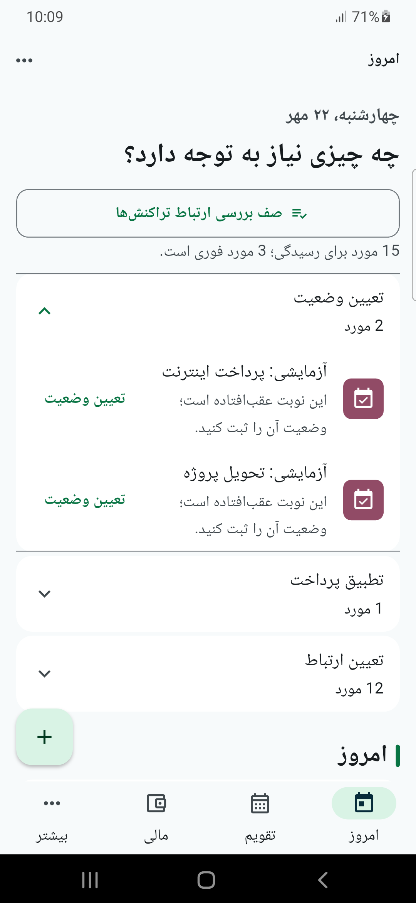
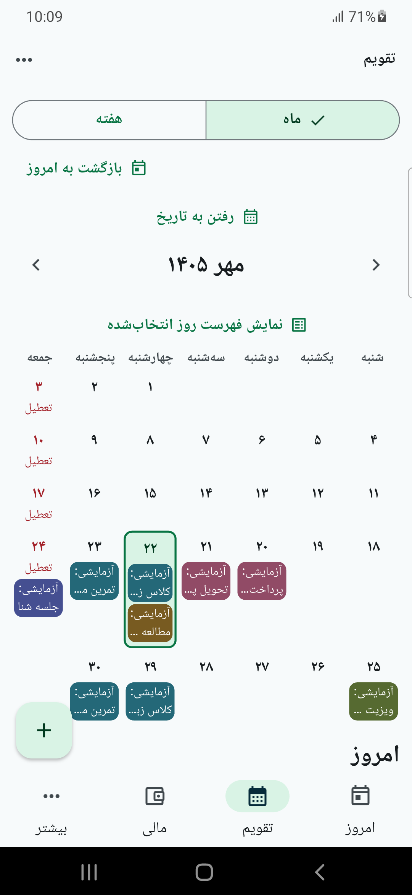
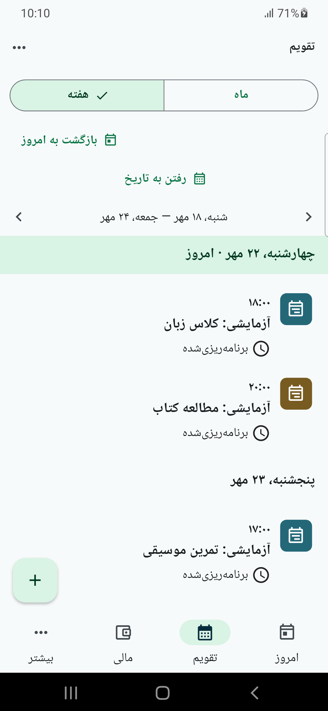
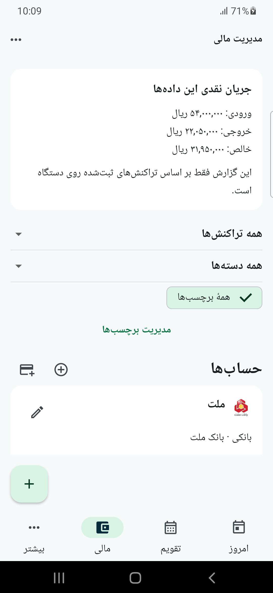
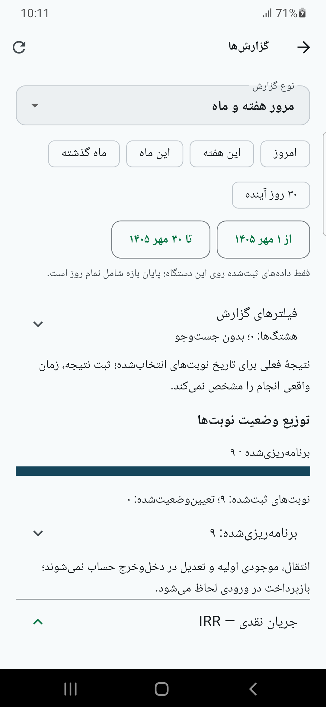
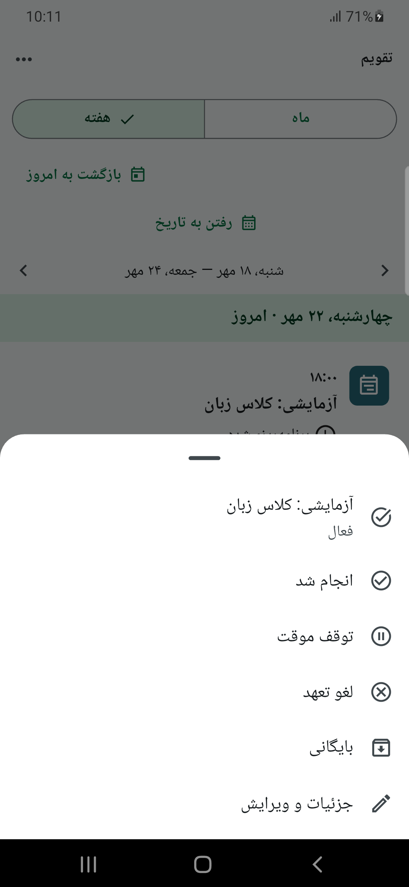
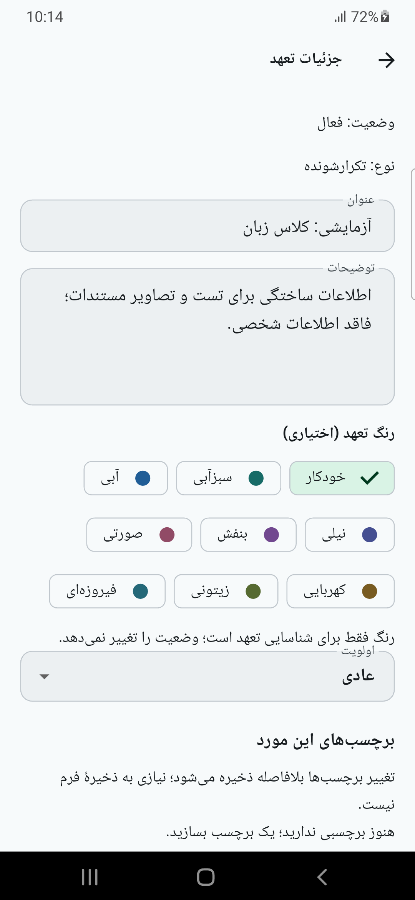

# پلن‌اکت در چند تصویر

پلن‌اکت برنامه‌ها، تعهدها و پرداخت‌های مرتبط با آن‌ها را کنار هم قرار می‌دهد تا بدانید چه کاری در پیش دارید و چه چیزی نیاز به رسیدگی دارد. در این گالری می‌توانید نمایی از کلاس‌ها، تمرین‌ها و پرداخت‌های روزمره را ببینید.

تصاویر از نسخهٔ آزمایشی ۰٫۱٫۱۵ روی گوشی گرفته شده‌اند. تعهدها و مبالغ نمونه‌اند و برای آشنایی با محیط برنامه نمایش داده می‌شوند.

## امروز و تقویم ماه

صفحهٔ «امروز» موارد نیازمند توجه، از تعیین وضعیت یک نوبت تا بررسی ارتباط پرداخت‌ها، را یک‌جا نشان می‌دهد. تقویم ماه نیز برنامه‌ها را در کنار تاریخ‌های جلالی و تعطیلات نمایش می‌دهد؛ با انتخاب هر روز می‌توانید برنامهٔ همان روز را مرور کنید.

| امروز | تقویم ماه |
| --- | --- |
|  |  |

## برنامهٔ هفتگی و امور مالی

در نمای هفته، برنامهٔ هر روز همراه ساعت شروع و وضعیت آن دیده می‌شود؛ مانند کلاس زبان عصر چهارشنبه یا تمرین موسیقی پنجشنبه. بخش مالی، خلاصهٔ دخل‌وخرج و حساب‌ها را نشان می‌دهد و امکان مرور تراکنش‌ها بر اساس نوع، دسته و برچسب را فراهم می‌کند.

| برنامهٔ هفته | امور مالی |
| --- | --- |
|  |  |

## گزارش‌ها و مدیریت تعهد

گزارش‌ها برای مرور یک بازهٔ زمانی، دیدن وضعیت نوبت‌ها و بررسی جریان نقدی به کار می‌آیند. از منوی هر تعهد نیز می‌توانید آن را انجام‌شده اعلام کنید، موقتاً متوقف کنید، لغو یا بایگانی کنید، یا وارد جزئیات و ویرایش شوید.

| گزارش‌ها | منوی تعهد |
| --- | --- |
|  |  |

## جزئیات یک تعهد

در صفحهٔ جزئیات می‌توانید عنوان و توضیحات تعهد را ویرایش کنید، برای شناسایی آسان‌تر آن رنگ انتخاب کنید و اولویت یا برچسب‌هایش را مشخص کنید. در این نمونه، جزئیات یک کلاس زبان را می‌بینید.

برای آشنایی بیشتر با امکانات و وضعیت فعلی برنامه، [معرفی پلن‌اکت](../README.md) را بخوانید.
